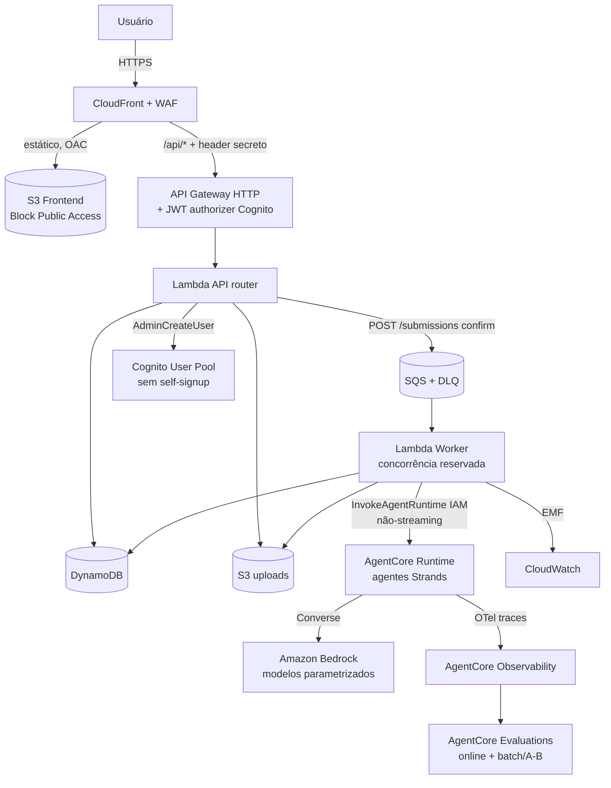

# Design — Exam Correction v2

## Visão geral

Plataforma serverless de correção de provas com IA. A correção é **assíncrona
(job-based)**: o usuário envia um arquivo, recebe um `submissionId` e acompanha o
resultado por polling. Uma fila (SQS) desacopla ingestão de processamento e controla
concorrência para não estourar quotas de modelo. **Não há streaming.**

Prioridade de design (nesta ordem): **simplicidade → serverless → segurança → custo**.

O sistema é composto por **duas Lambdas** (uma API-router e um worker), **agentes Strands
hospedados no AgentCore Runtime**, **uma stack CDK**, **um `index.html` estático** e os
modelos acessados via **Amazon Bedrock Converse API** (direto). A qualidade dos agentes é
medida pelo **AgentCore Evaluations**. A v1 permanece intocada em `OldVersion/`; a
tentativa anterior (SAM/React) foi descartada e preservada em `OldVersion-sam/`.

Todo conteúdo de correção e a UI são em **PT-BR**.

### Princípios de design

- **Configuração, não hardcode:** modelos, rubricas, provas e estratégias são dados
  versionados. Nenhum modelo fixo no código (corrige a v1).
- **Assíncrono por padrão:** ingestão desacoplada da execução; worker com concorrência
  controlada e idempotência. Sem streaming.
- **Agentes gerenciados:** a lógica de correção vive em **agentes Strands no AgentCore
  Runtime**; o worker só faz a ponte `SQS → InvokeAgentRuntime`. O browser nunca fala com
  o Runtime.
- **Avaliação gerenciada:** qualidade/A-B via **AgentCore Evaluations** (online + batch),
  alimentado pelos traces do Runtime — sem harness/scorers próprios.
- **Mensurável:** toda invocação de modelo registra tokens, custo e latência (CloudWatch
  EMF + AgentCore Observability).
- **Simplicidade estrutural:** 2 Lambdas, 1 stack, 1 página, agentes gerenciados.
- **Fases:** núcleo primeiro (fase 1); cartão resposta e evaluations na fase 2.

---

## Arquitetura de alto nível

### Fluxo de correção (assíncrono)

1. FE (autenticado via Cognito Hosted UI/PKCE) chama `POST /api/submissions` → a API cria
   o registro `PENDING_UPLOAD` e devolve uma **URL pré-assinada** de upload.
2. FE faz `PUT` do arquivo direto no S3 e chama `POST /api/submissions/{id}/confirm` → a
   API valida o upload, marca `QUEUED`, enfileira na **SQS** e responde `202`.
3. O **worker** consome a fila, faz claim idempotente `QUEUED→PROCESSING`, resolve a
   `model_config` (primário + challenger) e invoca o agente adequado no **AgentCore
   Runtime** (`InvokeAgentRuntime`, resposta completa, **sem streaming**).
4. O agente (Strands) transcreve (modelo multimodal via Converse) e corrige (rubrica ou
   gabarito/modelo). Os traces vão para o **AgentCore Observability**; tokens/custo/latência
   também são emitidos pelo worker via EMF.
5. O worker grava `corrections`, atualiza a submissão para `DONE` (ou `FAILED` → DLQ). Se
   houver challenger e a política sortear, invoca o agente também com o modelo challenger em
   **shadow** (`isChallenger=true`), sem afetar a nota.
6. FE faz **polling** de `GET /api/submissions/{id}` até `DONE`.
7. O **AgentCore Evaluations** pontua os traces em modo **online** (amostra/shadow) e/ou
   **batch** (contra golden set), alimentando a tela de Avaliação de Modelos/Agentes.

---

## Componentes

### Agentes (Strands no AgentCore Runtime)

Cada agente é um agente **Strands** (Python) com system prompt próprio e saída JSON
validada por schema, empacotado e implantado no **AgentCore Runtime** via **CodeZip**
(sem Docker local). Os agentes chamam o modelo via **Bedrock Converse** e são
instrumentados com **OpenTelemetry** (traces → Observability → Evaluations).

| Agente | Responsabilidade | Saída |
|--------|------------------|-------|
| `transcription` | Transcrever redação (texto) ou pares pergunta/resposta (prova) de imagem/PDF | `{text}` ou `{transcricao[]}` |
| `essay` | Corrigir redação por 1+ rubricas | `{criteria[]{score,maxScore,feedback}, totalScore, feedback}` |
| `exam` | Corrigir prova discursiva (estratégia gabarito ou modelo) | `{questoes[]{nota,notaMaxima,justificativa}, notaTotal}` |
| `author` | Wizard: gerar resposta de referência a partir do enunciado | `{resposta}` |
| `answersheet` (fase 2) | Corrigir cartão resposta contra gabarito de múltipla escolha | `{questoes[], nota}` |

A escolha de modelo de **transcrição** e de **correção** é independente (`model_config`
por capacidade), permitindo modelo econômico para uma etapa e forte para outra. O modelo é
passado ao agente em cada invocação (payload do `InvokeAgentRuntime`), nunca hardcoded.

### Acesso a modelos — Bedrock Converse (direto)

- Os agentes usam a **Converse API** do Amazon Bedrock nativamente (via Strands), com o
  `modelId` resolvido em runtime a partir da `model_config`.
- **Multimodal:** imagem/PDF enviados como blocos de conteúdo Converse (bytes + media type
  detectado — corrige o `media_type` fixo da v1).
- **Multi-modelo / A-B / judge:** o worker invoca o agente com `modelId` = primário para a
  nota oficial; e com `modelId` = challenger em **shadow** quando a política sortear.
- **Métricas:** o campo `usage` da resposta Converse alimenta `common/metrics` (EMF).
- **Gateway (Mantle):** não usado na fase 1. Se surgir necessidade de modelos no Mantle, o
  agente troca o cliente Converse por uma chamada ao endpoint OpenAI-compatível do
  AgentCore Gateway, sem mudar o restante do fluxo.

### Avaliação — AgentCore Evaluations

- **Online:** avaliação contínua sobre amostra do tráfego de produção (inclui o challenger
  em shadow), pontuando os traces dos agentes.
- **Batch/on-demand:** um **runner** fino executa um alvo (agente + modelo + estratégia +
  rubrica/gabarito) sobre um **dataset/golden set** versionado (S3/DynamoDB) e dispara o
  batch evaluation.
- **Avaliadores:** LLM-as-judge (qualidade do feedback/aderência à rubrica) e code-based
  (erro numérico da nota vs. referência), built-in e/ou custom.
- Resultados por modelo/agente/versão alimentam a tela de Avaliação (R9) e os Analytics
  (R8). Fase 2.

---

## Modelo de dados (DynamoDB)

| Tabela | Chave | Campos principais |
|--------|-------|-------------------|
| `submissions` | PK `submissionId` (GSI `byOwner`) | `type` (essay\|exam\|sheet), `status`, `ownerId`, `s3Key`, `options`, `result`, timestamps |
| `corrections` | PK `correctionId` | `submissionId`, `type`, `result`, `grade`, `modelUsed`, `transcriptionModel`, `isChallenger`, `ownerId` |
| `rubrics` | PK `rubricId`, SK `version` | `name`, `criteria[]{name,maxScore,description}`, `status`, `isDefault`, `totalMaxScore` |
| `exams` | PK `examId`, SK `version` | `title`, `questions[]{prompt,referenceAnswer,maxScore}`, `ownerId`, `status` |
| `model_config` | PK `capability` | `primaryModel`, `challengerModel`, `abPolicy{percent}` |
| `test_registry` | PK `testId` | `ownerId`, `examId`, `examVersion`, `studentId`, `disciplineId`, `classId`, `academicPeriod`, `institutionId`, `revoked` |
| `eval_datasets` / `eval_runs` (fase 2) | PK `datasetId` / `runId` | golden sets e execuções do harness/Evaluations |

Estados da submissão: `PENDING_UPLOAD → QUEUED → PROCESSING → DONE | FAILED`.
Idempotência por `submissionId` (claim condicional). Sem KB/S3 Vectors.
S3: `uploads/{type}/{submissionId}/original.<ext>`.

---

## API da aplicação

Uma **HTTP API** (API Gateway) com **JWT authorizer (Cognito)** + validação de header
secreto de origem (só CloudFront). Uma única Lambda (`backend/api/handler.py`) roteia por
path. Papéis via grupos Cognito: `admin`, `professor`. Erros: `{code, message(PT-BR)}`.
A API **não** invoca o Runtime — apenas registra/consulta submissões; a correção é feita
pelo worker.

| Rota | Descrição | Req |
|------|-----------|-----|
| `POST /api/submissions` | Cria submissão + URL pré-assinada | R16.2 |
| `POST /api/submissions/{id}/confirm` | Valida upload, enfileira (202) | R16.2 |
| `GET /api/submissions/{id}` | Estado + resultado | R16.6 |
| `GET /api/submissions` | Histórico (admin: `?all=true`) | R10 |
| `GET/POST/PUT /api/rubrics[/{id}]` | Rubricas (CRUD + versão; escrita = admin) | R2 |
| `GET/POST/PUT /api/exams[/{id}]` | Provas (CRUD + versão; escrita = admin) | R4 |
| `POST /api/exams/{id}/suggest-answer` | Wizard de resposta (admin) | R4.3 |
| `GET/PUT /api/model-config[/{capability}]` | Seleção primário/challenger (PUT = admin) | R7 |
| `POST/GET /api/test-registry[/{testId}]` | Vínculo TestID↔dono | R5 |
| `GET /api/analytics` | Métricas reais (DynamoDB + CloudWatch) | R8 |
| `GET /api/evaluations` | Resultados de avaliação (fase 2) | R9 |
| `POST /api/admin/users` | Criar usuário (admin, `AdminCreateUser`) | R11.8 |
| `GET /api/health` | Health check | — |

O wizard de resposta (`suggest-answer`) invoca o agente `author` no Runtime de forma
síncrona (é uma ação interativa de admin, não uma submissão de aluno).

---

## Seleção de modelos e A/B (R7)

- `model_config` guarda, por capacidade, `primaryModel`, `challengerModel` e `abPolicy`.
- O worker sempre invoca o agente com o **primário** (nota oficial). Se houver challenger e
  o sorteio (`abPolicy.percent`) acertar, invoca novamente com o modelo challenger em
  **shadow** (`isChallenger=true`), sem afetar o aluno.
- Promover challenger → primário = `PUT /model-config/{capability}` (admin).
- Modelos são identificadores parametrizados (nunca fixos no código). `DEFAULT_MODEL_ID`
  (`.env`) opcionalmente semeia todas as capacidades no deploy.

---

## Fila e throttling (R16)

- **SQS + DLQ** (`maxReceiveCount`). Worker com **reserved concurrency** calibrada às
  quotas do modelo (`WORKER_CONCURRENCY`).
- `ReportBatchItemFailures` para reprocessar só o que falhou; retry/backoff+jitter do boto3.
- Idempotência por claim condicional `QUEUED→PROCESSING`.
- A invocação do Runtime é síncrona dentro do worker (não-streaming); o timeout do worker
  acomoda a latência da correção (bem abaixo dos 15 min do Lambda).

---

## Métricas e observabilidade (R8)

- **AgentCore Observability:** traces de execução dos agentes (spans por etapa/tool/model),
  base para as Evaluations.
- **CloudWatch EMF:** o worker emite, por invocação, dimensões (capability, model, outcome)
  e métricas (tokensIn, tokensOut, latencyMs, costUsd). Custo estimado por `MODEL_PRICING`
  (env) — modelos sem preço cadastrado ficam sem custo (não quebram).
- `GET /api/analytics` combina contagens do DynamoDB (por status/tipo) com agregações do
  CloudWatch. Substitui o mock da v1.

---

## Frontend (R12)

- **1 `index.html` estático** (HTML/CSS/JS vanilla), servido pelo CloudFront a partir do S3.
  Sem React/Vite/MUI/Router.
- **Login:** Cognito **Hosted UI** com **PKCE** (sem "criar conta" na tela).
- **Menu lateral:** Correção de Redação, Correção de Prova Discursiva, Criação de Prova,
  Histórico, Dados Analíticos, Avaliação de Modelos, Rubricas, Configuração de Modelos,
  Cartão Resposta (fase 2).
- **Padrão assíncrono:** upload (URL pré-assinada) → confirm → polling do `submissionId` →
  exibe resultado. Upload multi-formato (PNG/JPG/PDF). O QR (TestID) é renderizado no FE.

---

## Segurança (R11, R17, Well-Architected)

- **Ponto de entrada único:** CloudFront serve o FE (S3 via **OAC** + Block Public Access) e
  faz proxy de `/api/*` para a HTTP API. A API valida um **header secreto** (Secrets
  Manager) injetado pelo CloudFront → não responde fora do CloudFront. **WAF** com regras
  gerenciadas + rate limit.
- **Cognito sem self-signup** (`AllowAdminCreateUserOnly`), senha forte, MFA opcional, troca
  no 1º acesso. Grupos `admin`/`professor`; ações administrativas restritas a `admin`.
  `ownerId` vem do token (substitui o `student` fixo da v1).
- **Agentes isolados:** o **AgentCore Runtime** é invocado apenas pelo worker via **IAM**
  (privilégio mínimo); nunca exposto ao usuário final. O browser só alcança o CloudFront.
- **IAM de privilégio mínimo** por Lambda/agente (nada de `*FullAccess`). Criptografia em
  repouso (S3/DynamoDB/SQS) e em trânsito (TLS). Segredos em Secrets Manager/SSM.
  **PII fora do QR**.
- **Confiabilidade:** fila + DLQ + retries + idempotência. **Custo:** modelo por tarefa,
  on-demand, custo medido por invocação.

---

## Infraestrutura (R14)

- **AWS CDK (Python), 1 stack** (`infra/exam_stack.py`): Cognito, S3 (FE + uploads),
  DynamoDB, SQS + DLQ, 2 Lambdas, HTTP API + authorizer, CloudFront + WAF, Secrets Manager
  (header de origem), e os recursos do **AgentCore Runtime/Evaluator** (construct alpha
  `aws_bedrock_agentcore_alpha` ou custom resource quando não houver cobertura em CFN).
- **Deploy dos agentes:** `scripts/deploy-agents.sh` usa o **AgentCore starter toolkit/CLI**
  para empacotar (CodeZip) e implantar os agentes Strands no Runtime — **sem Docker**.
- **Deploy reproduzível** via `scripts/deploy.sh` (cdk deploy → deploy dos agentes → build/
  sync do FE no S3 → invalidação do CloudFront). Parametrizado por `.env` (região, stack,
  admin inicial, concorrência, modelo default). Sem credenciais no código.

---

## Tratamento de erros

- Erros de agente/tool → `{code, message}` em PT-BR, sem vazar internals.
- Falha transitória → retry/reentrega SQS; persistente → DLQ + submissão `FAILED`.
- Entrada não-corrigível (imagem ilegível, TestID inexistente) → estado auditável, sem
  travar a fila.

---

## Estratégia de testes

- **Unit (pytest):** contrato JSON dos agentes (com mock do cliente Converse), `json_utils`,
  `metrics` (custo), `gabarito`, rubrica default, roteamento da API, idempotência do worker
  (com mocks de boto3/`InvokeAgentRuntime`).
- **Integração:** fluxo upload→confirm→fila→worker→Runtime→resultado em ambiente de dev
  (requer deploy).

---

## Faseamento

**Fase 1 (núcleo):** Cognito + API + CDK; fila + worker + idempotência; agentes Strands no
Runtime (transcrição, redação, prova, autor); rubricas; criação de prova + wizard;
TestID/QR; métricas + analytics; seleção de modelos + A/B; frontend com menu lateral.

**Fase 2:** cartão resposta (R6), evaluations via AgentCore Evaluations (R9) e harness
(dataset + runner batch) (R15).

---

## Rastreabilidade Requisito → Componente

| Requisito | Onde é atendido |
|-----------|-----------------|
| R1 Agentes | Agentes Strands no AgentCore Runtime + Converse; worker invoca via IAM |
| R2 Rubricas | `rubrics` versionado + agente `essay` + rotas rubrics |
| R3 Discursiva (gabarito/modelo) | Agente `exam` + `common/gabarito` |
| R4 Criação de prova + wizard | `exams` + agente `author` + rotas exams |
| R5 QR/TestID | `test_registry` + QR no FE + tool `read_test_id` (decodificação real = follow-up) |
| R6 Cartão resposta | Agente `answersheet` + tool `read_answer_sheet` (fase 2) |
| R7 Modelos/A-B | `model_config` + worker (primário/challenger) + config no FE |
| R8 Métricas | AgentCore Observability + EMF + `GET /analytics` |
| R9 Evaluations | AgentCore Evaluations (online + batch) + `GET /evaluations` (fase 2) |
| R10 Histórico | `corrections` + `GET /submissions` |
| R11 Cognito | User Pool (sem self-signup, admin-create) + JWT authorizer |
| R12 FE | `index.html` vanilla + menu lateral + PKCE |
| R13 Remoção legados | Sem scanner/Alexa; v1 preservada |
| R14 IaC | CDK 1 stack + scripts de deploy (infra + agentes) |
| R15 Harness | Dataset + runner sobre AgentCore Evaluations (fase 2) |
| R16 Fila/throttling | SQS + DLQ + worker com concorrência controlada |
| R17 Segurança de borda | CloudFront + OAC + WAF + header secreto + TLS/least-privilege + Runtime só via IAM |
