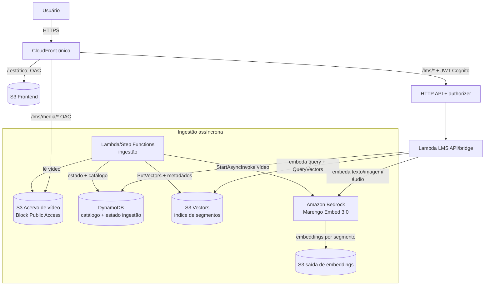
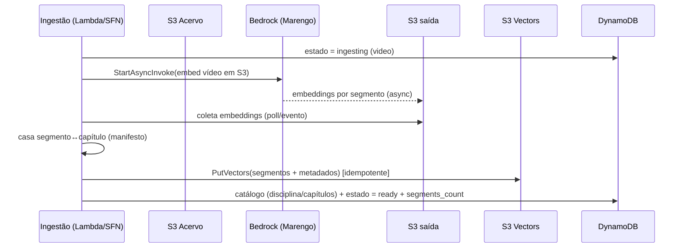

# Design — Módulo LMS de Vídeo (busca multimodal)

## Visão geral

Módulo serverless de **busca e interação com vídeos-aula**. O usuário busca por **texto**,
**voz/áudio** ou **detalhes visuais** (imagem/cena) e é levado ao **trecho exato** do vídeo
(deep-link por timestamp). O entendimento de vídeo vem do **TwelveLabs Marengo Embed 3.0**
no Amazon Bedrock, que joga vídeo, texto, imagem e áudio no **mesmo espaço vetorial** — por
isso um único índice (**Amazon S3 Vectors**) atende as três modalidades de consulta.

Prioridade de design (nesta ordem): **simplicidade → serverless → segurança → custo**.

O módulo é **plugável** e segue o padrão de Entrevistador/Orientador: um construct CDK
próprio (`infra/modules/lms.py`) com recursos próprios, servido pelo **mesmo CloudFront**
sob `/lms/*` (API) e `/lms/media/*` (playback), protegido pela mesma auth (Cognito). O
acervo inicial (um vídeo por disciplina + `manifest.json`) é gerado por
`assets/lms-demo/build_lms_videos.py`. A taxonomia (6 cursos, 89 disciplinas, muitas
**compartilhadas**) vem do módulo Orientador.

Toda a UI e o conteúdo são em **PT-BR**.

### Princípios de design

- **Um índice, várias modalidades:** o espaço vetorial unificado do Marengo permite que
  texto, áudio e imagem consultem o mesmo índice de segmentos de vídeo (*any-to-any*).
- **Metadados ricos = busca + navegação + avaliação:** o `manifest.json` dá capítulos com
  timestamp e texto narrado. Isso vira metadado dos segmentos (busca/realce), navegação por
  capítulos e *ground-truth* de avaliação — sem banco extra.
- **Assíncrono na ingestão, síncrono na consulta:** embutir vídeo é async (Marengo
  `StartAsyncInvoke` → S3). Consultas (texto/imagem) são síncronas; áudio conforme suporte.
- **Borda única e privilégio mínimo:** nada público fora do CloudFront; bucket com OAC +
  Block Public Access; IAM restrito aos modelos/recursos usados.
- **Mensurável:** auto-avaliação de acerto de timestamp usando os capítulos como consultas.
- **Faseado:** núcleo (3 buscas + player + navegação/filtros + auto-eval) na Fase 1;
  "trechos parecidos" e Pegasus (resumo/Q&A) na Fase 2.

---

## Arquitetura de alto nível



O **browser nunca fala com o Bedrock, com o S3 Vectors nem com o bucket do acervo**: só com
o CloudFront (API sob `/lms/*`, mídia sob `/lms/media/*`). A Lambda do módulo faz a ponte.

---

## Componentes

### 1. Acervo e geração (assets)
- `assets/lms-demo/build_lms_videos.py` gera 1 vídeo por disciplina (8 capítulos, ritmo
  adaptativo, vozes mescladas) + imagens (Bedrock Stability) + narração (Amazon Polly) e o
  **`manifest.json`** (disciplina, cursos, capítulos com `start_sec`/`dur_sec`/`voice`/
  `narration`). Vídeos/imagens/áudios ficam em `assets/lms-demo/{videos,images,audio}/`
  (fora do git); o `manifest.json` é versionado.
- Em produção/demo, os vídeos do `videos/` são publicados no bucket S3 do acervo.

### 2. Infra (`infra/modules/lms.py`)
Construct CDK próprio, expondo o necessário para o `exam_stack.py` registrar os behaviors:
- **S3 Acervo** (privado, BPA, OAC) para os `.mp4`; prefixo separado para saída de
  embeddings do Marengo.
- **S3 Vectors**: índice de segmentos (dimensão do Marengo; métrica cosseno).
- **DynamoDB**: `lms_catalog` (disciplinas/capítulos derivados do manifesto) e
  `lms_ingest` (estado por vídeo: pendente/ingerindo/pronto/falhou).
- **Lambda LMS** (API/bridge): rotas de catálogo e busca; embeda a query no Marengo e
  consulta o S3 Vectors.
- **Ingestão**: Lambda (ou Step Functions p/ o padrão async do Marengo) que dispara
  `StartAsyncInvoke`, aguarda/coleta a saída no S3 e faz `PutVectors` no índice.
- **HTTP API + JWT authorizer** (reusa `user_pool`/`user_pool_client` do portal).
- Expõe `self.api_domain` (para o behavior `/lms/*`) e a origem S3 do acervo (para
  `/lms/media/*`), ambos ligados no `exam_stack.py`.

### 3. Backend (`lms/`)
- `lms/api/handler.py`: router das rotas HTTP (catálogo + busca).
- `lms/ingest/handler.py`: ingestão (StartAsyncInvoke, coleta, PutVectors, atualização de
  catálogo/estado). Idempotente por `disc_id`/`video`.
- `lms/common/`: cliente Marengo (embed texto/imagem/áudio/vídeo), cliente S3 Vectors,
  parsing do manifesto, montagem de metadados de segmento.

### 4. Frontend (`frontend/`)
- Novo capítulo "LMS" no menu (`app.js`): player + barra de busca com seletor de modo
  (**texto / voz / imagem**), lista de resultados (miniatura + capítulo + disciplina +
  cursos + timestamp), chips de capítulos e filtros (curso/disciplina/área/semestre).

---

## Modelo de dados

### Índice S3 Vectors (por segmento)
Cada vetor representa um **segmento** do vídeo, com metadados:

| Campo | Descrição |
|---|---|
| `id` | `{disc_id}#{video}#{start_sec}` (estável, idempotente) |
| `vector` | embedding do segmento (Marengo) |
| `disc_id`, `area`, `semester` | da disciplina |
| `programs` | lista de cursos (permite descoberta cruzada) |
| `video` | caminho relativo do `.mp4` (para montar `/lms/media/...`) |
| `start_sec`, `end_sec` | janela do segmento |
| `chapter_index`, `chapter_title`, `narration` | capítulo correspondente (casado por tempo) |

### DynamoDB
- **`lms_catalog`** (PK `disc_id`): nome, área, semestre, créditos, `programs`, `video`,
  lista de capítulos (do manifesto), duração.
- **`lms_ingest`** (PK `video`): estado (`pending`/`ingesting`/`ready`/`failed`),
  `segments_count`, timestamps, `async_invoke_arn`, erro (se houver).

> O casamento **segmento → capítulo** usa a janela de tempo: o capítulo cujo
> `[start_sec, start_sec+dur_sec)` contém o centro do segmento.

---

## Fluxo de ingestão (assíncrono)



- **Idempotência:** `id` de segmento determinístico; reprocessar sobrescreve, não duplica.
- **Resiliência:** estado por vídeo permite retomar; falha marca `failed` para reprocessar.
- **Escala/custo:** ingestão sob demanda; região us-east-1 (suporte ao Marengo Embed 3.0).

---

## Fluxos de consulta

Comum a todas: a Lambda embeda a **query** no Marengo (mesmo espaço), faz `QueryVectors`
no S3 Vectors (top-k, com filtros de metadado), resolve cada hit para
`vídeo + timestamp + capítulo + disciplina + cursos + score` e devolve ao frontend, que
abre o player no `start_sec`.

```mermaid
flowchart LR
    Q[Query: texto | áudio | imagem] --> E[Marengo embed query]
    E --> QV[S3 Vectors QueryVectors + filtros]
    QV --> R[Top-k segmentos]
    R --> M[Resolve metadados: vídeo/timestamp/capítulo/cursos]
    M --> UI[Resultados com deep-link]
```

- **Texto (R4):** embed de texto (síncrono) → encontra conteúdo falado **e** visual.
- **Voz/áudio (R5):** embed de um clipe de áudio; conforme o suporte do modelo, a consulta
  por áudio pode ser assíncrona — a Lambda trata isso preservando a mesma saída.
- **Detalhes visuais (R6):** embed de **imagem** de referência, ou descrição textual da
  cena (cai na busca por texto).
- **Filtros/escopo (R7):** `programs`/`disc_id`/`area`/`semester` aplicados como filtros de
  metadado no `QueryVectors`; escopo (acervo/curso/disciplina) idem.
- **Descoberta cruzada:** como `programs` é lista, um mesmo trecho pode ser marcado como
  relevante para vários cursos; a UI mostra "aparece nos cursos X, Y".

---

## Playback seguro

- Vídeos servidos por CloudFront sob `/lms/media/*`, origem S3 com **OAC** + **Block Public
  Access**; o browser nunca acessa o bucket direto.
- O player faz *seek* para o `start_sec` do resultado (deep-link). Reproduzível a partir de
  qualquer instante.

---

## Wiring no `exam_stack.py`

Seguindo o padrão dos outros módulos, sob o conjunto `modules` (ex.: `-c modules=...,lms`):

```python
if "lms" in modules:
    lms = LmsModule(self, "Lms", stack_name=self.stack_name,
                    user_pool=user_pool, user_pool_client=client, boto3_layer=boto3_layer)
    # API
    distribution.add_behavior("/lms/*",
        origins.HttpOrigin(lms.api_domain, protocol_policy=HTTPS_ONLY),
        viewer_protocol_policy=REDIRECT_TO_HTTPS, allowed_methods=ALLOW_ALL,
        cache_policy=CACHING_DISABLED,
        origin_request_policy=ALL_VIEWER_EXCEPT_HOST_HEADER,
        response_headers_policy=security_headers)
    # Mídia (S3/OAC)
    distribution.add_behavior("/lms/media/*",
        origins.S3BucketOrigin.with_origin_access_control(lms.media_bucket),
        viewer_protocol_policy=REDIRECT_TO_HTTPS,
        cache_policy=CACHING_OPTIMIZED, response_headers_policy=security_headers)
```

---

## Segurança

- API só via CloudFront `/lms/*` + **JWT authorizer (Cognito)** do portal.
- IAM mínimo: `bedrock:InvokeModel`/`StartAsyncInvoke` **apenas** para os modelos usados
  (Marengo Embed 3.0; Pegasus na fase 2); S3 Vectors (Put/Query) só no índice do módulo;
  S3 só no bucket do acervo; DynamoDB só nas tabelas do módulo.
- CORS restrito ao domínio do CloudFront. Config/segredos em SSM/Secrets Manager.

---

## Qualidade mensurável (auto-avaliação)

- Rotina de avaliação (batch/on-demand) usa cada **capítulo** como consulta
  (`chapter_title`/`narration`) e verifica se o top-1/top-k segmento retornado cai dentro
  da **janela de tempo** daquele capítulo (acerto de timestamp).
- Métricas: precision@k e taxa de acerto de timestamp por modalidade; latência e scores por
  consulta. Alinha-se ao princípio "mensurável e reproduzível".

---

## Observabilidade e custo

- Ingestão: nº de segmentos e tempo por vídeo; estado em `lms_ingest`.
- Busca: modalidade, latência, nº de resultados (logs estruturados + métricas CloudWatch).
- Custo consciente: um vídeo por disciplina (acervo enxuto), ingestão sob demanda,
  S3 Vectors (serverless/pay-per-use), consultas síncronas leves.

---

## Faseamento

- **Fase 1 (núcleo):** infra do módulo; publicação do acervo; ingestão Marengo → S3
  Vectors; buscas **texto**, **voz/áudio** e **detalhes visuais**; player com deep-link;
  navegação por capítulos + filtros (incl. descoberta cruzada); auto-avaliação de timestamp.
- **Fase 2:** "trechos parecidos" (segmento → similares no acervo); **Pegasus** (resumo/
  capítulos automáticos/Q&A por vídeo); painel de qualidade/A-B.

## Decisões travadas

- Índice vetorial = **S3 Vectors** (serverless, já usado no módulo Provas Online).
- 3 modalidades de busca (texto, voz/áudio, detalhes visuais) em **um único índice**
  (espaço unificado do Marengo).
- Narração fica como **metadado do segmento** no S3 Vectors (sem banco de texto à parte).
- Playback via CloudFront `/lms/media/*` (S3/OAC), bucket privado.
- Marengo **Embed 3.0**, região **us-east-1**. Pegasus só na Fase 2.
