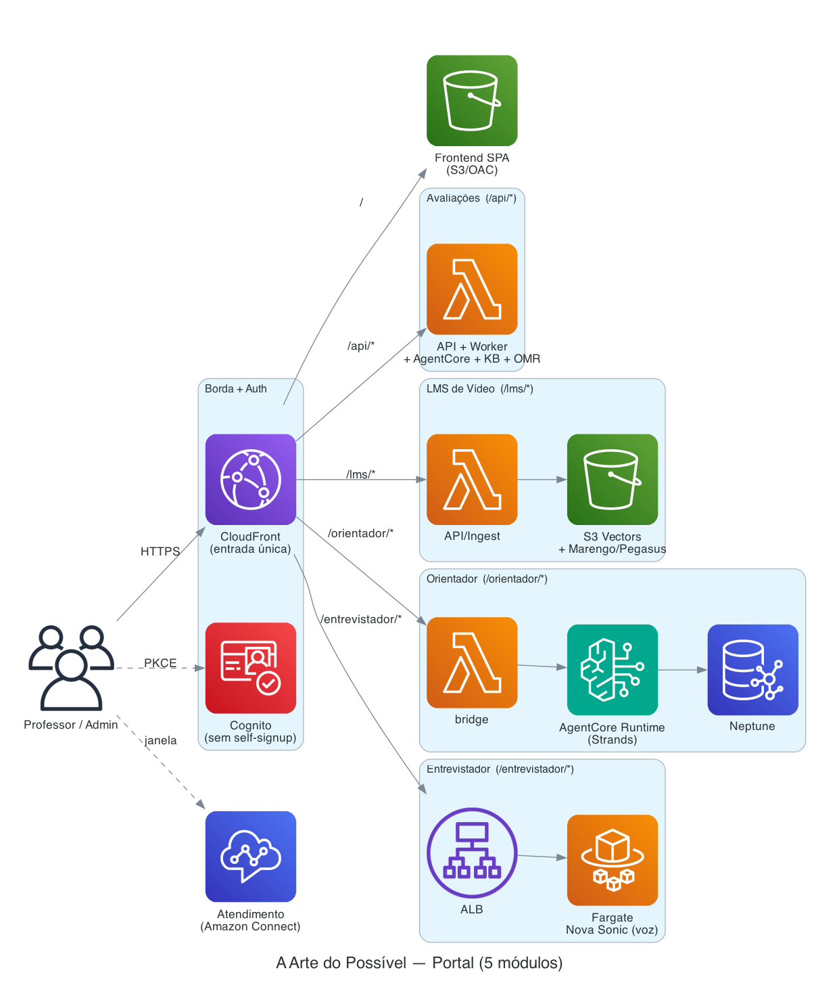

# A Arte do Possível — Plataforma Educacional (Exam Correction v2)

Plataforma **serverless-first**, em **PT-BR**, que reúne cinco módulos de IA aplicada à
educação sob um **único ponto de entrada (CloudFront)** e um **login único (Cognito)**.

Ordem de prioridade do projeto: **simplicidade → serverless → segurança → custo**.

---

## Módulos

| Módulo | O que faz | Stack principal | Doc |
|---|---|---|---|
| **Avaliações** | Correção de redação, prova discursiva, cartão-resposta (OMR) e provas online (RAG) | Lambda + SQS + AgentCore + KB + OpenCV | [`avaliacao/README.md`](avaliacao/README.md) · [`docs/ARCHITECTURE.md`](docs/ARCHITECTURE.md) |
| **LMS de Vídeo** | Busca multimodal (texto/imagem/voz) em videoaulas + resumo/Q&A | Marengo + S3 Vectors + Pegasus | [`lms/README.md`](lms/README.md) |
| **Entrevistador** | Entrevista por voz em tempo real + relatório de RH | Nova Sonic + ECS Fargate + WebSocket | [`interviewer/README.md`](interviewer/README.md) |
| **Orientador Acadêmico** | Trilhas por knowledge graph + modo coordenador (grade de horários) | Neptune + AgentCore (Strands) | [`orientador-academico/README.md`](orientador-academico/README.md) |
| **Atendimento** | Central omnichannel (voz/chat/WhatsApp) | Amazon Connect (embed) | [`docs/modules/atendimento.md`](docs/modules/atendimento.md) |

Além de **Analytics** (observabilidade) no nível do portal.

---

## Arquitetura macro



<sub>Diagrama como código: `docs/architecture/portal.py` — regenere com `python3 docs/architecture/portal.py`.</sub>

Tudo público **somente atrás do CloudFront**: S3 via OAC, APIs/ALB só aceitam o **header secreto
de origem**. Cognito **sem self-signup** (grupos `admin`/`professor`).

---

## Menu do portal

```
Avaliações ─ Prova Discursiva · Redação · Prova Objetiva · Provas Online · Configuração · Evaluation
LMS de Vídeo ─ Busca em Vídeo · Catálogo · Qualidade
Entrevistador Virtual ─ Entrevista · Vagas · Avatar · Histórico
Orientador Acadêmico ─ Alunos · Cursos · Carreiras · Chat · Trilha · Grafo · Insights · …
Atendimento ─ Chat
──────────
Analytics ─ Dados Analíticos
```

---

## Pré-requisitos

- Conta AWS com acesso ao **Amazon Bedrock** e ao **Bedrock AgentCore** na região de deploy.
- **Credenciais via `aws configure`/SSO** (nunca chaves estáticas no repo).
- **Node 20+** (CDK CLI), **Python 3.12**, **AWS CLI v2**, **finch ou docker** (imagens ARM64 do
  Entrevistador e do agente Orientador), **Graphviz** (só para regenerar o diagrama raiz PNG).
- **Model access** no console do Bedrock: modelo(s) de chat/visão, **Titan Text Embeddings V2**
  (KB), **Nova Sonic** (entrevistador), **TwelveLabs Marengo/Pegasus** (LMS).
- `pip install bedrock-agentcore-starter-toolkit strands-agents` (agentes de Avaliações).

---

## Configuração (`.env` na raiz)

```bash
cp .env.example .env    # o .env real é ignorado pelo git
```

| Variável | Descrição |
|---|---|
| `AWS_REGION` / `STACK_NAME` | Região e nome da stack. |
| `WORKER_CONCURRENCY` | Concorrência reservada do worker de Avaliações. |
| `DEFAULT_MODEL_ID` | Opcional; semeia as capacidades de Avaliações. |
| `DEPLOY_KB` · `KB_ID`/`KB_BUCKET` | KB demo vs KB próprio (Provas Online). |
| `BOOTSTRAP_ADMIN_EMAIL` | 1º admin. |

**Nunca** versione `AWS_ACCESS_KEY_ID`/`SECRET`. Use profile/SSO ou credenciais temporárias.

---

## Setup — projeto raiz

**Um comando** provisiona a stack única e o núcleo:

```bash
DEPLOY_KB=1 BOOTSTRAP_ADMIN_EMAIL=admin@escola.edu.br ./scripts/deploy.sh
```

O `deploy.sh` faz, numa ordem só: layer OMR (se `BUILD_OMR_LAYER=1`) → KB demo (se `DEPLOY_KB=1`)
→ **CDK** (stack única + `OriginSecret`, passando `omrLayerArn`/`kbId`/`kbBucket` por contexto) →
Cognito/CORS/seed → publica frontend → agentes de Avaliações. Cada peça é **opcional e
desacoplada**.

## Setup — por módulo

Os módulos são habilitados por **feature flag** no CDK (`-c modules=...`) e finalizados por um
script próprio. O deploy roda **da cópia off-OneDrive** (`~/dev/exam-build`), pois o OneDrive
trava operações de empacotamento/synth.

```bash
# contexto completo do CDK (habilita os módulos e mantém KB/OMR/orientador):
cdk deploy \
  -c modules=correcao,entrevistador,orientador,lms \
  -c kbId=<KB_ID> -c kbBucket=<KB_BUCKET> \
  -c omrLayerArn=<ARN_LAYER_OMR> --parameters OriginSecret=<segredo>
```

| Módulo | Flag | Passo final |
|---|---|---|
| Avaliações | `correcao` | `./scripts/deploy-agents.sh` (agentes CodeZip) · `DEPLOY_KB=1` (KB) |
| LMS | `lms` | `./scripts/deploy-lms.sh` (acervo + índice S3 Vectors + ingestão) |
| Entrevistador | `entrevistador` | imagem ARM64 sobe no `cdk deploy` (Fargate) |
| Orientador | `orientador` | `./scripts/deploy-orientador-agent.sh` (AgentCore em VPC) |
| Atendimento | — | setup no **Amazon Connect** (ver doc do módulo) |

---

## Deploy — convenções e gotchas (consolidados)

- **Deploy incremental de código** (evita rotacionar o `OriginSecret` a cada `cdk deploy`):
  - Lambda (Avaliações/LMS): `aws lambda update-function-code`.
  - Frontend: `aws s3 cp app.js/styles.css` + `aws cloudfront create-invalidation`.
  - `cdk deploy` **só quando a infra muda**.
- **Rodar do build dir off-OneDrive** (`~/dev/exam-build`): o OneDrive trava `cdk synth` e o
  empacotamento de assets (layers, imagens).
- **AgentCore em VPC (Orientador)** — o toolkit `agentcore` (v0.1.x) **removeu o suporte a VPC**;
  por isso o deploy do agente **não usa o toolkit**: builda a imagem ARM64 (finch/docker) e chama
  `bedrock-agentcore-control update-agent-runtime` **reusando a networkConfiguration VPC**
  (subnets privadas **com NAT**). Detalhes e armadilhas (`requireServiceS3Endpoint` imutável,
  `runtimeSessionId` ≥ 33 chars, `action=load` com `--cli-read-timeout` alto) em
  [`orientador-academico/README.md`](orientador-academico/README.md).
- **Toolchain de container:** Entrevistador e agente Orientador são **imagens ARM64**; agentes de
  Avaliações usam **CodeZip** (sem Docker).

---

## Custos (referência `us-east-1`, sujeito a mudança)

| Módulo | Fixo (ocioso) | Variável (por uso) |
|---|---|---|
| Avaliações | ~US$ 1–3/mês (Secrets/DynamoDB/S3; sem WAF) | tokens de LLM na correção; **cartão OMR ~US$ 0,0001/un (sem LLM)** |
| LMS | ~centavos/mês (S3 Vectors ~4 MB) | ingestão Marengo **~US$ 2 única**; busca ~centavos; **Pegasus ~US$ 0,024/chamada** |
| Entrevistador | **Fargate + ALB ~US$ 22–28/mês** (persistente) | Nova Sonic por minuto de voz |
| Orientador | **Neptune** (maior custo ocioso; cluster de pé) | Nova Pro por invocação |
| Atendimento | US$ 0 no repo | pricing do Amazon Connect (voz/min, chat/msg) |

Os módulos serverless (Avaliações/LMS) custam **~centavos parados**. **Entrevistador (Fargate+ALB)**
e **Orientador (Neptune)** têm **custo fixo relevante** por serem persistentes — considere
pausar/reduzir quando ociosos.

---

## Estrutura do repositório

```
infra/                  # CDK (stack única): Cognito, S3, DynamoDB, SQS+DLQ, Lambdas, HTTP API,
  exam_stack.py         #  CloudFront, AgentCore Runtime; modules/ = entrevistador, lms, orientador
avaliacao/              # módulo Avaliações — backend/ (common,api,worker) + agents/ + tests/
lms/                    # módulo LMS de Vídeo (common,api,ingest,eval) + tests
interviewer/            # módulo Entrevistador (FastAPI+WebSocket, Fargate) + Dockerfile
orientador-academico/   # módulo Orientador (agent/, bridge/, src/, data/) + Dockerfile
frontend/               # SPA vanilla: index.html + app.js + styles.css (+ opencv.js)
assets/kb-demo/         # acervo SINTÉTICO do KB (Provas Online) — só demonstração
scripts/                # deploy.sh, deploy-agents.sh, deploy-kb.sh, deploy-lms.sh,
                        #  deploy-orientador-agent.sh, build-omr-layer.sh, test-all.sh, smoke-test.sh
docs/                   # ARCHITECTURE.md (núcleo) + architecture/ (diagrama) + modules/atendimento.md
OldVersion/ · OldVersion-sam/  # v1 e tentativa SAM (referência; NUNCA modificar)
.kiro/specs/            # exam-correction-v2, lms-video (requirements/design/tasks)
```

---

## Segurança (Well-Architected)

- **Ponto de entrada único no CloudFront**; S3 via OAC + Block Public Access; APIs/ALB só com o
  **header secreto** de origem; HTTPS obrigatório. (Ambiente de teste **sem WAF** — em produção,
  adicione WAF WebACL.)
- **Cognito** sem self-signup, senha forte, MFA opcional, grupos `admin`/`professor`.
- **IAM de privilégio mínimo** por Lambda/agente; Runtimes só acessíveis via IAM.
- Criptografia em repouso/trânsito; segredos no Secrets Manager/SSM (nunca no bundle do FE).
- **PII fora do QR** (só `testId`/`ID_Exam`); CORS restrito ao domínio do CloudFront.

---

## Testes

```bash
./scripts/test-all.sh        # regressão de todos os módulos (avaliacao, orientador, lms, interviewer)
./scripts/smoke-test.sh      # e2e ao vivo contra a infra (via CloudFront)

# por módulo:
cd avaliacao && python3 -m pytest -q
cd lms && python3 -m pytest -q
cd orientador-academico && .venv/bin/python -m pytest -q     # venv próprio

cd infra && cdk synth        # valida a infraestrutura

# regenerar os diagramas (PNG via biblioteca `diagrams` + Graphviz):
pip install diagrams   # + brew install graphviz
for d in portal avaliacao lms interviewer orientador atendimento; do python3 docs/architecture/$d.py; done
```

---

## Licenças de terceiros

Dependências e licenças em [`THIRD-PARTY-NOTICES.md`](THIRD-PARTY-NOTICES.md). Destaque: o
`opencv-python-headless` embarca **FFmpeg (LGPL-2.1+)**; o OpenCV.js é servido ao navegador sob
**Apache-2.0**.
