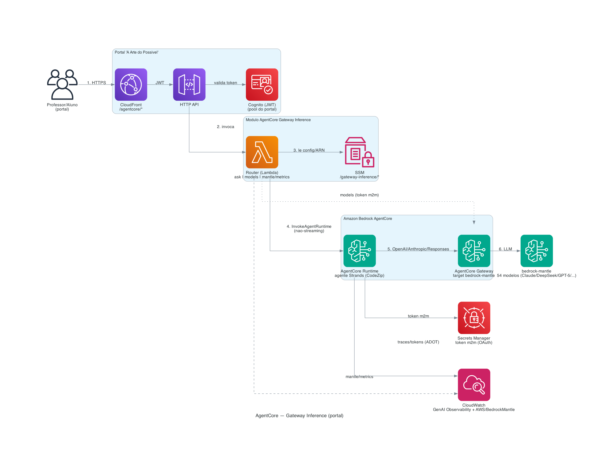

# AgentCore — Gateway Inference

Módulo do portal "A Arte do Possível" que traz, para dentro do portal, as capacidades do
projeto **inference-demo** (proxy unificado de inferência via **Amazon Bedrock AgentCore
Gateway**, target `bedrock-mantle`) — mas hospedando o agente no **AgentCore Runtime** (não
mais em Fargate) e com **observability nativa** do AgentCore.

Menu no portal: **AgentCore → Gateway Inference →** `Inference`, `Evaluation`, `History`,
`Mantle-config`, `Keys`, `System-prompt`.

> **Reusa** a infra já implantada do inference-demo (`InferenceDemoStack`): o **Gateway**
> (`inferencedemogatewayv2`, 54 modelos) e o **Cognito m2m**. Não recria Gateway/Cognito.

## Arquitetura

```
Navegador (portal) ──/agentcore/*──► CloudFront ──► HTTP API + JWT (Cognito do portal)
                                                            │
                                                   Router (Lambda)
                        ┌───────────────────────────────────┼───────────────────────────┐
                        │ /ask (chat/eval)                   │ /models        │ /mantle/metrics
                        ▼                                     ▼                ▼
              InvokeAgentRuntime                     Gateway /models    CloudWatch
                        ▼                             (token m2m)       AWS/BedrockMantle
        AgentCore Runtime (agente Strands, CodeZip)                    (tokens/inferências/modelo)
          · provider OpenAI/Anthropic/Responses ──► AgentCore Gateway (target bedrock-mantle) ──► LLMs
          · token OAuth m2m (Secrets Manager)          (54 modelos: Claude, DeepSeek, Gemma, GPT-5, …)
          · observability nativa (ADOT) ─────────────► CloudWatch GenAI Observability
```

- **Runtime, não Fargate.** O inference-demo usava Fargate por causa do streaming; aqui o
  chat é **não-streaming** via `InvokeAgentRuntime`, então o agente roda no **AgentCore
  Runtime** (CodeZip, sem Docker/VPC/ALB) — mais simples e barato, e com observability nativa.
- **Roteamento por API** (igual ao `pick_api` do inference-demo), pois cada modelo do
  bedrock-mantle fala só UMA API: `anthropic.*` → Messages; `openai.gpt-5*`/`gpt-oss*` →
  Responses; resto → Chat Completions. Feito pelos providers do Strands
  (`AnthropicModel` / `OpenAIResponsesModel` / `OpenAIModel`).
- **Segurança:** o browser nunca fala com o Gateway nem vê o segredo m2m; só o Router
  (IAM próprio) e o Runtime. Config no **SSM** `/gateway-inference/*`; segredo no
  **Secrets Manager**. JWT do Cognito do portal no HTTP API.



> Fonte versionada em `docs/architecture/agentcore-gateway-inference.py` (lib `diagrams` +
> Graphviz). Re-render: `python3 agentcore-gateway-inference/docs/architecture/agentcore-gateway-inference.py`.

## Capacidades (submenus)

| Submenu | O que faz | Onde roda |
|---|---|---|
| **Inference** | Chat com qualquer um dos 54 modelos (picker por provider) + painel de debug (modelo, tokens, latência, gateway). | Runtime → Gateway |
| **Evaluation** | Mesmo prompt em até 3 modelos em paralelo + **LLM-as-a-judge** (nota accuracy/completeness/relevance/clarity, vencedor). | Runtime (N×/ask) |
| **History** | Benchmark por modelo (nota média, vitórias, nº de avaliações) + últimas runs. | Navegador (localStorage) |
| **Mantle-config** | **Observability** do Gateway: tokens/inferências por modelo (CloudWatch `AWS/BedrockMantle`) + KPIs, com seletor de janela. | Router → CloudWatch |
| **System-prompt** | System prompt customizado guardado na sessão do navegador; enviado em toda inferência. | Navegador |
| **Keys** | *(próxima fase)* trazer chave OpenAI/Gemini via **AgentCore Identity** para usar pelo mesmo Gateway. | — |

## Componentes

- `runtime/agent.py` — agente **Strands** no AgentCore Runtime; mint do token m2m, roteamento
  por API e chamada ao Gateway. Observability nativa (ADOT). Config via SSM.
- `runtime/deploy-runtime.sh` — resolve a config do `InferenceDemoStack` → SSM, `agentcore
  launch` (CodeZip) e IAM least-privilege (SSM GetParameter + Secrets GetSecretValue).
- `api/handler.py` — **Router (Lambda)**: `/agentcore/api/{health,models,ask,mantle/metrics}`.
  `ask` faz a ponte para o Runtime; `models` lista o Gateway; `mantle/metrics` lê o CloudWatch.
- `deploy/` — stack CDK standalone (Lambda + HTTP API + Cognito do portal + IAM), behavior
  `/agentcore/*` no CloudFront (`cloudfront_behavior.py`), `deploy.sh` e `teardown.sh`.

## Deploy

```bash
# 1) Agente no Runtime (uma vez / a cada mudança do agente):
cd agentcore-gateway-inference/runtime && ./deploy-runtime.sh
# 2) Bridge + rota no portal + frontend:
cd agentcore-gateway-inference/deploy && ./deploy.sh
```

> Nota: o `deploy.sh` roda `cloudfront_behavior.py` e publica o `app.js` com o `python` do
> `.venv` do CDK, que **não** tem boto3. Rode esses dois passos com um python que tenha boto3
> (ex.: reuse um venv com boto3) — o CDK e o resto do fluxo funcionam normalmente.

## Verificação

```bash
curl -s https://<cloudfront>/agentcore/health                 # {"ok":true,...}
# models -> 54 modelos; ask -> resposta via Runtime->Gateway; mantle/metrics -> tokens por modelo
```

Verificado ponta a ponta: `/models` = 54 modelos/12 providers; `/ask` respondendo com Chat
(deepseek), Messages (claude) e Responses (gpt-5.5) via Runtime→Gateway; `/mantle/metrics`
= tokens/inferências por modelo do CloudWatch `AWS/BedrockMantle`.

## Estado / custo

No ar: Runtime `gateway_inference`, stack `agentcore-gateway-inference`, behavior `/agentcore/*`.
Reusa o `InferenceDemoStack` (Gateway + Cognito m2m) — que tem custo próprio (Fargate/ALB/NAT
do inference-demo). Este módulo em si é serverless (Runtime CodeZip + Lambda), paga por uso.
Teardown do módulo: `agentcore-gateway-inference/deploy/teardown.sh` (+ `agentcore` para o Runtime).
