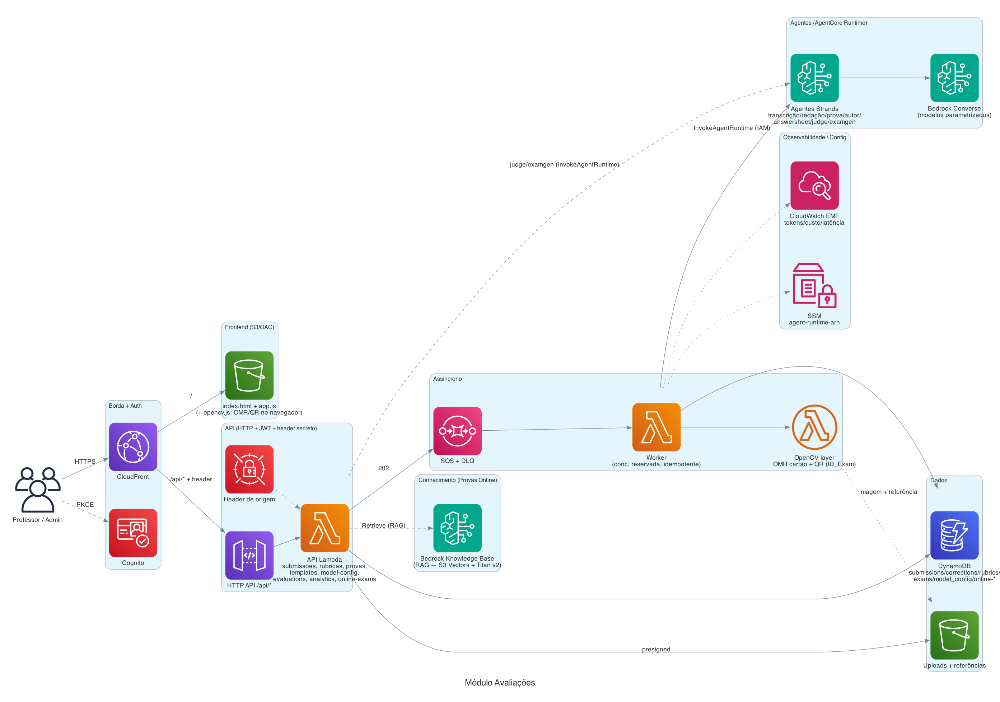

# Módulo Avaliações

Núcleo do portal **A Arte do Possível**: leitura e **correção de provas** assistida por IA,
em **PT-BR**, 100% serverless. É o módulo "guarda-chuva" que reúne quatro tipos de avaliação
(discursiva, redação, objetiva/cartão-resposta e provas online) + a configuração de modelos e
o painel de qualidade (model-as-judge).

> Antes chamado `backend/` + `agents/` na raiz. Agora vive em `avaliacao/` (código das Lambdas
> em `avaliacao/backend/`, agentes do AgentCore em `avaliacao/agents/`).

Detalhes profundos de subsistemas (OMR, model-as-judge, provas online, deploy incremental)
estão em [`../docs/ARCHITECTURE.md`](../docs/ARCHITECTURE.md). Este README dá a visão do
módulo, arquitetura, setup, custos e decisões.

---

## O que faz

- **Redação** — correção por **rubricas** (padrão ENEM), nota por critério + feedback.
- **Prova discursiva** — correção por questão via **gabarito** ou **conhecimento do modelo**;
  criação de prova com **wizard** de resposta de referência.
- **Prova objetiva (cartão-resposta)** — leitura das marcações por **OMR determinístico
  (OpenCV)**, no navegador e no servidor, com detecção de **QR (ID_Exam)** e upload em lote.
- **Provas Online** — gera provas (múltipla escolha ou discursivas) ancoradas numa **Bedrock
  Knowledge Base (RAG)**; o aluno responde no navegador; correção automática (MC determinística;
  discursiva por LLM) + sugestão de estudo por questão errada.
- **Configuração de modelos** — primário/challenger por capacidade + A/B; preços por modelo.
- **Qualidade / Evaluation** — model-as-judge compara saídas de modelos e aponta a melhor.

---

## Arquitetura



<sub>Diagrama como código: `docs/architecture/avaliacao.py` — regenere com `python3 docs/architecture/avaliacao.py`.</sub>

**Princípios:** correção é **assíncrona (job-based)** — `upload → 202 + submissionId → polling`,
sem streaming. O **browser nunca fala com o Runtime** (só o worker, via IAM). Modelos **nunca
hardcoded** (escolhidos por capacidade na tela de Configuração). Cartão-resposta é
**determinístico (sem LLM)**.

---

## Estrutura

```
avaliacao/
  backend/
    common/     # gabarito, rubrica ENEM, metrics (EMF/custo), http, authz, ids,
                #  model_config, runtime_client (InvokeAgentRuntime), online_grading (KB/RAG),
                #  json_utils, schemas, rubric_seed
    api/        # router único: submissions, rubrics, exams, card-templates, evaluations,
                #  model-config, pricing, analytics, online-exams, online-attempts, admin/users
    worker/     # worker SQS (ponte → Runtime) + omr.py (OpenCV: leitura de cartão + QR)
  agents/       # agentes Strands (AgentCore Runtime, deploy CodeZip):
                #  transcription, essay, exam, author, answersheet, judge, examgen
  tests/        # pytest do módulo (+ pytest.ini)  — from common/api/worker import ...
```

Runtime da Lambda: `common/`, `api/`, `worker/` ficam na raiz do `sys.path` (o handler é
`api.handler.handler` / `worker.handler.handler`). Os agentes são empacotados à parte e
publicados no AgentCore Runtime.

---

## Fluxos principais

**Correção de imagem (redação/discursiva/cartão)**
1. `POST /api/submissions` → cria registro + URL S3 pré-assinada.
2. `POST /api/submissions/{id}/confirm` → valida upload e enfileira (`202`).
3. Worker: redação/discursiva → agentes (transcrição → correção) no Runtime; cartão → OMR
   OpenCV local; lê QR → `ID_Exam`. Persiste `corrections` + status.
4. `GET /api/submissions/{id}` → polling do resultado.

**Provas Online (estudo, requer KB)**
1. `POST /api/online-exams` → API recupera trechos do KB (`bedrock:Retrieve`) e o agente
   `examgen` gera as questões ancoradas nos trechos.
2. `POST /api/online-exams/{id}/attempts` → enfileira; worker corrige (MC determinística;
   discursiva via capacidade `exam`).
3. Questão errada → sugestão de estudo (trecho da apostila do KB + página).

**Model-as-judge** — `POST /api/evaluations/run` invoca o agente `judge` (síncrono) para
comparar saídas de modelos diferentes; grava a avaliação no histórico.

---

## Serviços AWS e segurança

- **Bedrock** (Converse) via AgentCore Runtime; capacidades: `transcription`, `essay`, `exam`,
  `author`, `answersheet`, `examgen` (+ `judge`).
- **Bedrock Knowledge Base** (S3 Vectors + Titan v2) — só a **API** acessa (Provas Online).
- **DynamoDB** (on-demand, PITR), **S3** (uploads/frontend/KB), **SQS+DLQ**, **Cognito**
  (grupos `admin`/`professor`, sem self-signup), **CloudFront** (OAC + header secreto),
  **Secrets Manager** (`OriginSecret`), **SSM** (ARN do Runtime).
- **IAM de privilégio mínimo** por Lambda; Runtime só acessível via IAM pelo worker/API.
- **Layer OpenCV** (`opencv-python-headless`+`numpy`, ~189 MB) publicada por
  `scripts/build-omr-layer.sh`; import de `cv2` é **tardio** (só no caminho de cartão).

---

## Configuração (`.env` na raiz)

| Variável | Descrição |
|---|---|
| `AWS_REGION` | Região (padrão `us-east-1`). |
| `STACK_NAME` | Nome da stack CDK. |
| `WORKER_CONCURRENCY` | Concorrência reservada do worker (limita chamadas simultâneas ao Bedrock). |
| `DEFAULT_MODEL_ID` | Opcional. Semeia todas as capacidades; vazio = configurar pela UI. |
| `DEPLOY_KB` | `1` = provisiona o KB de demonstração. |
| `KB_ID` / `KB_BUCKET` | KB próprio (produção) em vez do demo. |
| `BOOTSTRAP_ADMIN_EMAIL` | 1º admin. |

---

## Deploy

Faz parte da **stack única** (`infra/exam_stack.py`) — é o núcleo, não um módulo opcional.

```bash
# infra + seed + frontend + agentes, tudo numa ordem só:
DEPLOY_KB=1 BOOTSTRAP_ADMIN_EMAIL=admin@escola.edu.br ./scripts/deploy.sh

# deploy dos agentes (CodeZip, sem Docker) no AgentCore Runtime:
./scripts/deploy-agents.sh
```

**Deploy incremental** (evita rotacionar o `OriginSecret` a cada `cdk deploy`): mudanças de
código da Lambda usam `aws lambda update-function-code`; frontend usa `aws s3 cp` + invalidação
do CloudFront. `cdk deploy` só quando a **infra** muda.

> Detalhe importante: o CDK empacota a Lambda de `../avaliacao/backend` (asset). O
> `deploy-agents.sh` copia `avaliacao/agents/*` + `avaliacao/backend/common/{__init__,json_utils}.py`
> para o pacote CodeZip do Runtime.

---

## Custos

Divididos em **fixo (ocioso)** e **variável (por uso)**. Referência `us-east-1`, sujeito a mudança.

- **Ocioso** (mensal): Secrets Manager ~US$ 0,40; DynamoDB/S3/S3 Vectors do KB ~centavos;
  CloudFront/Cognito/SQS/SSM ~free tier; AgentCore Runtime = US$ 0 ocioso. **Total ≈ US$ 1–3/mês**
  (sem WAF, que foi removido neste ambiente de teste).
- **Variável:** dominado por **tokens de LLM (Bedrock)** na correção de redação/discursiva,
  transcrição, `examgen` e judge — medido nas Analytics por modelo.
- **Cartão-resposta (OMR):** **determinístico, sem LLM** → só CPU do worker.
  ~**US$ 0,08–0,20 por 1.000 cartões** no servidor (~US$ 0,0001/cartão); no navegador, ~US$ 0,02/1.000.
  Comparado a ler cartão por LLM (~US$ 20–40/1.000), é **~200–400× mais barato**.

---

## Decisões travadas e lições

- **Assíncrono/job-based** (SQS + worker), nunca streaming.
- **Agentes = Strands no AgentCore Runtime** (deploy CodeZip, sem Docker); o worker só faz a
  ponte `SQS → InvokeAgentRuntime`.
- **OMR determinístico** para múltipla escolha (confiável e barato); LLM só onde agrega
  (redação/discursiva).
- **Modelos parametrizados** por capacidade (`model_config`), com A/B (`single`/`ab`/`both`).
- **KB só pela API** (fronteira de segurança); worker não acessa KB.
- **QR carrega só `testId`/`ID_Exam`** — PII fora do QR.

---

## Testes

```bash
cd avaliacao && python3 -m pytest -q        # lógica portável (prompts, schemas, A/B, custo, rubrica, OMR)
# ou, de qualquer módulo, a regressão geral:
./scripts/test-all.sh
```

---

## API (resumo)

Todas as rotas sob `/api` (mesma origem do CloudFront; **JWT Cognito** obrigatório).

| Método | Rota | Descrição |
|--------|------|-----------|
| POST | `/submissions` | Cria submissão + URL pré-assinada (essay/exam/answersheet) |
| POST | `/submissions/{id}/confirm` | Valida upload e enfileira (202) |
| GET | `/submissions[/{id}]` | Histórico / estado + resultado (inclui `idExam`) |
| DELETE | `/submissions/{id}` | Apaga submissão (correções + imagem S3 + registro) |
| GET | `/submissions/{id}/corrections` | Correções + transcrições |
| GET | `/submissions/{id}/image` | URL pré-assinada da imagem original |
| PUT | `/submissions/{id}/transcription-rating` · `/corrections/{id}/rating` | 👍/👎 |
| POST | `/submissions/{id}/answersheet-result` | Salva leitura OMR do navegador (+`idExam`) |
| GET/POST/PUT/DELETE | `/card-templates[/{id}]` (+`/reference`) | Templates de cartão |
| GET/POST | `/evaluations/candidates` · `/evaluations/run` | Model-as-judge |
| GET/POST | `/online-exams` · `/online-exams/{id}` · `/online-exams/{id}/attempts` | Provas online |
| GET/POST | `/online-exams/themes` · `/online-exams/kb-doc?uri=` | Temas do KB / download |
| GET/DELETE | `/online-attempts[/{id}]` · POST `/online-attempts/{id}/study` | Tentativas + estudo |
| GET/POST/PUT | `/rubrics[/{id}]` · `/exams[/{id}]` · POST `/exams/{id}/suggest-answer` | Versionados (escrita = admin) |
| GET/PUT | `/model-config[/{capability}]` · `/pricing` · GET `/models` | Seleção de modelos e preços |
| POST/GET | `/test-registry[/{testId}]` | Vínculo TestID ↔ dono (QR sem PII) |
| GET | `/analytics` · POST `/admin/users` · GET `/health` | Métricas · criar usuário · health |

## Provas Online — formato do acervo do KB

Requer uma **Bedrock Knowledge Base** criada e **sincronizada**. Convenções do acervo (bucket de
origem do KB), sob `KB_THEMES_PREFIX` (padrão `privado/graduacao/eng-software/`):

- `*_material.pdf` — apostila de conteúdo (priorizada nas sugestões de estudo).
- `*_email.pdf` — comunicados; **excluídos** da geração e do estudo.
- Sidecar `<nome>.pdf.metadata.json` por documento (formato Bedrock) com `metadataAttributes`:
  `disciplina` (vira o **tema** selecionável), `semestre` (ordena), `curso_id`, `tipo_documento`,
  `is_apostila`. Documentos sem `disciplina` não aparecem como tema.

Provisionamento: **demo** (`DEPLOY_KB=1 ./scripts/deploy.sh`, acervo sintético em `assets/kb-demo/`)
ou **KB próprio** (`KB_ID`/`KB_BUCKET`). Sem KB, os demais fluxos de Avaliações funcionam; só Provas
Online fica indisponível.
