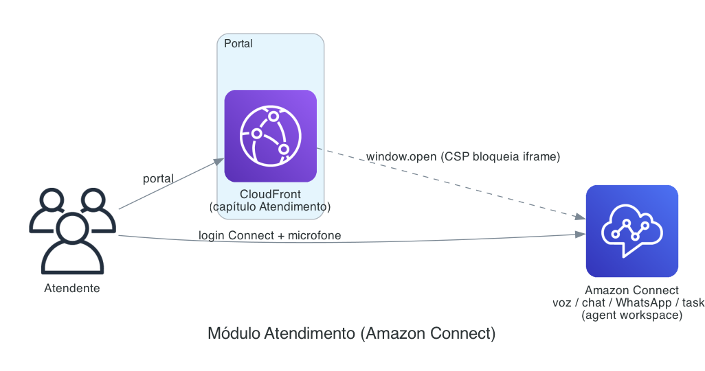

# Módulo Atendimento (Amazon Connect)

Central de atendimento omnichannel (voz, chat, WhatsApp, tasks) via **Amazon Connect**. Diferente
dos outros módulos, **não tem infraestrutura própria no CDK** nem código de backend: é um **embed**
do painel do Connect, aberto a partir do portal.

---

## Como funciona

O capítulo **Atendimento** do portal (`viewAtendimentoChat` no `frontend/app.js`) abre o
**workspace do agente do Amazon Connect** (`<instância>.my.connect.aws/agent-app-v2/`) em uma
**janela dedicada**.

Diagrama como código: `docs/architecture/atendimento.py` — regenere com `python3 docs/architecture/atendimento.py`.

> **Por que janela e não iframe:** a **CSP** (`frame-ancestors`) da instância `my.connect.aws`
> bloqueia o embed em iframe, mesmo com o domínio nos *Approved Origins*. Por isso o portal abre o
> painel do Connect numa janela separada (`window.open`).

---

## Setup (fora do CDK — no Amazon Connect)

O provisionamento é **no lado do Amazon Connect**, não neste repositório:

1. Criar/usar uma **instância do Amazon Connect** (habilitar os canais desejados: voz, chat,
   WhatsApp, tasks).
2. Configurar **filas, horários, contact flows** e **usuários/agentes** (perfis de segurança).
3. Adicionar o domínio do portal (CloudFront) aos **Approved Origins** da instância.
4. Publicar a **URL da instância** na configuração do frontend (`CONNECT_INSTANCE_URL` no
   `runtime-config.js` / `CFG`), lida pelo capítulo Atendimento.

No 1º acesso, o atendente faz **login no Connect** e permite o **microfone** para atender voz.

---

## Custos

Segue o **pricing do Amazon Connect** (pague-pelo-uso), independente do restante do portal:

- **Voz** — por minuto de uso (entrada/saída) + tarifas de telefonia (DID/toll-free).
- **Chat / tasks** — por mensagem/uso.
- **WhatsApp / mensageria** — conforme o canal.

Não há custo fixo neste repositório para o Atendimento (a instância do Connect é cobrada à parte,
conforme uso). Consulte a [calculadora AWS](https://calculator.aws) para números atuais.

---

## Decisões e observações

- **Sem infra no CDK**: o módulo é um ponto de integração com um serviço externo já gerenciado
  (Amazon Connect). Não há Lambda/DynamoDB/agente próprio.
- **Embed por janela** (não iframe), por causa da CSP do Connect.
- Não há dados de atendimento persistidos neste projeto — tudo vive no Amazon Connect.
