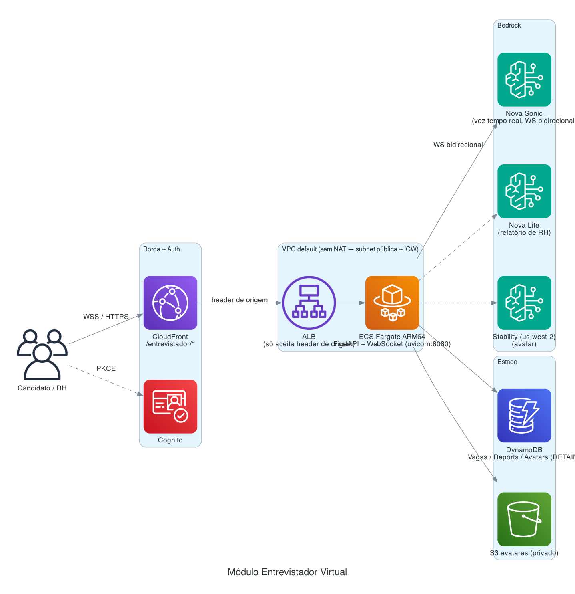

# Módulo Entrevistador Virtual

Simulador de **entrevista por voz em tempo real** com **Amazon Nova Sonic** (streaming
bidirecional de áudio) + avatar, e **relatório de avaliação de RH** ao final. Em PT-BR.

> **É a exceção deliberada ao serverless do portal.** Voz em tempo real precisa de conexão
> **persistente** (WebSocket), que não cabe no modelo Lambda/job-based. Por isso roda como
> **serviço em container (ECS Fargate)**, na mesma stack CDK e servido pelo mesmo CloudFront
> sob `/entrevistador/*`. O SPA embute a UI pelo capítulo *Entrevistador Virtual*.

---

## O que faz

- **Entrevista por voz** — o candidato fala; o Nova Sonic responde por voz em tempo real
  (barge-in, transcrição ao vivo), com um **avatar** e uma **vaga** de contexto.
- **Vagas** — CRUD de vagas (com geração assistida), semeadas e gerenciáveis.
- **Avatar** — imagens geradas (Stability) + calibração, gerenciáveis.
- **Histórico/Relatório** — ao fim, um relatório de RH (semáforo/score por dimensão) via Nova
  Lite, salvo e consultável.

---

## Arquitetura



<sub>Diagrama como código: `docs/architecture/interviewer.py` — regenere com `python3 docs/architecture/interviewer.py`.</sub>

**Rede:** usa a **VPC default** da conta (sem NAT, evita estourar quota de VPC). As tasks ficam
em **subnets públicas com IP público** (egress ao Bedrock via IGW); o security group só permite
ingresso a partir do **ALB**. O ALB é internet-facing mas **só aceita tráfego com o header
secreto de origem** injetado pelo CloudFront — nada acessível fora do CloudFront (mesmo padrão
da API do núcleo).

---

## Componentes

```
interviewer/
  server.py         # FastAPI: WS /ws (áudio bidirecional Nova Sonic), /api/* (vagas, reports,
                    #  avatars, generate-job), serve static/. Vozes pt-BR: carolina (fem) / leo (masc).
  static/           # UI (captura de mic 16kHz, avatar, transcrição, relatório com semáforo/score)
  Dockerfile        # imagem ARM64 (uvicorn:8080)
  requirements.txt
  tests/            # esqueleto (placeholder; cobertura real a escrever)
```

Infra em [`../infra/modules/entrevistador.py`](../infra/modules/entrevistador.py): Cluster ECS,
task Fargate ARM64 (`ContainerImage.from_asset('../interviewer')`), ALB, DynamoDB (Vagas/Reports/
Avatars) e S3 de avatares. O portal registra o behavior `/entrevistador/*` no CloudFront apontando
para o ALB.

---

## Serviços AWS e segurança

- **Bedrock Nova Sonic** (voz tempo real, WebSocket bidirecional) + **Nova Lite** (relatório) +
  **Stability** (avatar, us-west-2).
- **ECS Fargate** (ARM64) + **ALB** + **VPC default** (sem NAT).
- **DynamoDB** (Vagas/Reports/Avatars, PAY_PER_REQUEST, **RETAIN** — antes eram HTMLs no disco
  efêmero do container, se perdiam a cada deploy) + **S3** privado de avatares (servido pelo
  container; o browser nunca fala direto com o S3).
- Auth: mesmo Cognito do portal (o acesso é pelo CloudFront autenticado); o ALB exige o header
  de origem.

---

## Configuração (env do serviço)

`MODEL_ID` (`amazon.nova-2-sonic-v1:0`), `VOICE_ID`/`VOICE_ID_FEMALE` (`carolina`)/`VOICE_ID_MALE`
(`leo`), `IMAGE_MODEL_ID` (`stability.stable-image-ultra-v1:1`), `IMAGE_MODEL_REGION` (`us-west-2`),
`VAGAS_TABLE`, `REPORTS_TABLE`, `AVATARS_TABLE`, `AVATARS_BUCKET`, `BASE_PATH` (`/entrevistador`),
`AWS_REGION`.

---

## Rodar local

```bash
cd interviewer
python3 -m venv .venv && . .venv/bin/activate
pip install -r requirements.txt
cp .env.example .env      # credenciais temporárias — NUNCA commitar
uvicorn server:app --host 0.0.0.0 --port 8080
# http://localhost:8080/entrevistador
```

## Deploy

Sobe junto da stack quando o módulo está habilitado:

```bash
cdk deploy -c modules=...,entrevistador   # (via ./scripts/deploy.sh do build dir)
```

O CDK builda a imagem ARM64 (`from_asset`) e publica no ECR/Fargate. Mudança só de código do
container = novo `cdk deploy` do módulo (é imagem de container, não `update-function-code`).

---

## Custos (referência, sujeito a mudança)

Diferente dos demais: **tem custo fixo de Fargate** (task sempre de pé) + ALB.

- **Fixo (ocioso):** 1 task Fargate ARM64 pequena (~0.25 vCPU/0.5 GB) ~US$ 6–10/mês + **ALB
  ~US$ 16–18/mês** (LCU + horas). DynamoDB/S3 ~centavos.
- **Variável:** **Nova Sonic por minuto de conversa** (voz é o maior driver), Nova Lite (relatório,
  barato), Stability (avatar, por imagem, esporádico).

> É o módulo com maior **custo ocioso** do portal (Fargate + ALB), por ser persistente. Se ficar
> ocioso muito tempo, considere escalar a task a zero ou App Runner com scale-to-zero.

---

## Decisões e lições

- **Fora do serverless por necessidade** (WebSocket persistente) — exceção consciente.
- **VPC default sem NAT** (egress via IGW em subnet pública) — evita custo de NAT e quota de VPC;
  segurança pelo SG (só ALB) + header de origem no ALB.
- **Estado em DynamoDB/S3, não no disco do container** (RETAIN) — sobrevive a deploys.
- Vagas de exemplo (`static/jobs.json`) e avatares são **fictícios**, para demonstração.
