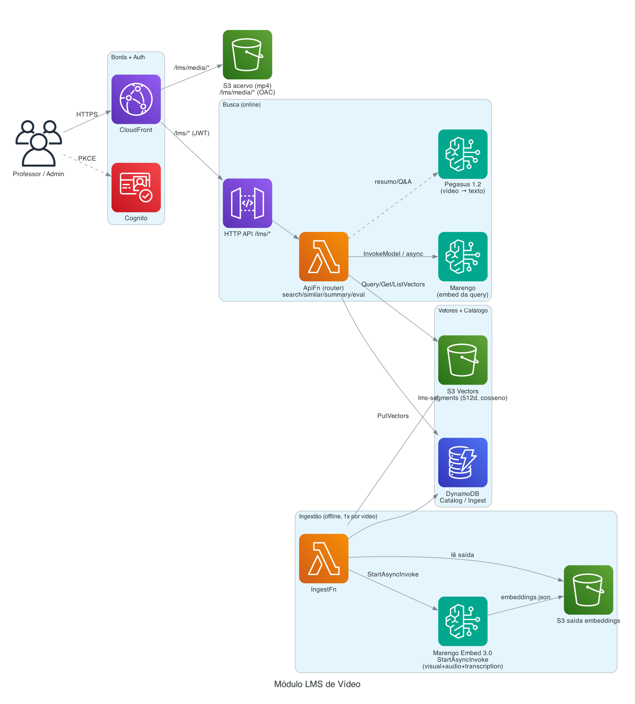

# Módulo LMS de Vídeo

Busca **multimodal** em videoaulas + resumo/Q&A por vídeo. Você procura por **texto**,
**imagem** (cena/objeto) ou **voz** e cai no **instante exato** da aula; pede **cenas
semelhantes** a um trecho; e gera **resumo/perguntas** sobre um vídeo. Tudo em PT-BR.

Pilares: **TwelveLabs Marengo Embed 3.0** (embeddings multimodais) + **Amazon S3 Vectors**
(vector store gerenciado) + **TwelveLabs Pegasus 1.2** (vídeo→texto). **Não usa Bedrock
Knowledge Base nem AgentCore** — é um pipeline próprio, fino e barato.

---

## O que faz

- **Busca por texto / imagem / voz** — embute a *query* no Marengo e faz similaridade vetorial
  no S3 Vectors; resultado é um trecho com **deep-link** (`.../video.mp4#t=start`).
- **Cenas semelhantes ao trecho atual** — usa o `currentTime` do player, resolve o segmento que
  cobre aquele instante e busca vizinhos (inclusive de outros cursos). Não chama o Marengo
  (reusa o vetor já indexado) → é o recurso mais barato.
- **Resumo / Q&A (Pegasus)** — envia o vídeo ao Pegasus e recebe resumo ou resposta em PT-BR.
- **Catálogo** por área/disciplina com capítulos clicáveis.
- **Qualidade da busca** — auto-avaliação sem curadoria: usa cada capítulo como consulta e mede
  se o trecho retornado cai no momento certo (precision@1 / hit@k / discipline@1).

---

## Arquitetura



<sub>Diagrama como código: `docs/architecture/lms.py` — regenere com `python3 docs/architecture/lms.py`.</sub>

Como o Marengo joga tudo no **mesmo espaço vetorial**, a busca é sempre "embute a query → acha
vizinhos". O vídeo **não é reprocessado na busca** — os embeddings dos trechos foram feitos na
ingestão.

---

## Estrutura

```
lms/
  common/    # config, marengo (client + builders v3), vectors (S3 Vectors), segments
             #  (casamento segmento↔capítulo + chave/metadados), manifest, store (DynamoDB), pegasus
  api/       # handler (router HTTP: /lms/health,catalog,search,similar,summary,ask,eval) + search
  ingest/    # handler (StartAsyncInvoke → coleta S3 → PutVectors; estado/idempotência)
  eval/      # evaluate (auto-avaliação da busca: precision@1/hit@k/discipline@1)
  tests/     # pytest (FakeMarengo/FakeVectors/FakeStore)
  conftest.py
```

**Índice S3 Vectors:** 1 vetor por `(segmento × modalidade)`. Chave determinística
`{disc_id}#{video}#{start_sec}#{modality}` (idempotente — reprocessar sobrescreve). Metadados
filtráveis (disc_id, area, semester, programs, modality, start/end, chapter_index) + não-filtráveis
(narration, chapter_title, name).

---

## Fluxos

- **Ingestão** (`scripts/deploy-lms.sh`): cria o vector bucket + índice → `aws s3 sync` dos mp4
  → invoca `IngestFn action=ingest` por disciplina. StartAsyncInvoke do Marengo (vídeo/áudio é
  assíncrono, grava embeddings no S3) → coleta → `PutVectors`.
- **Busca texto/imagem** — `InvokeModel` síncrono no Marengo → `QueryVectors` (cosseno).
- **Busca voz** — `StartAsyncInvoke` (áudio) + poll → `QueryVectors` `modality=audio`.
- **Cenas semelhantes** — `ListVectors` resolve o segmento no `at_sec` → `GetVectors` (vetor de
  origem) → `QueryVectors` (vizinhos, exclui o próprio).
- **Resumo/Q&A** — baixa o vídeo do S3, base64 inline (<25 MB) → `InvokeModel` no Pegasus.

---

## Serviços AWS e segurança

- **Amazon Bedrock**: Marengo `twelvelabs.marengo-embed-3-0-v1:0` (512d); Pegasus
  `us.twelvelabs.pegasus-1-2-v1:0` (inference profile — on-demand exige profile), us-east-1.
- **Amazon S3 Vectors** (`s3vectors`): `CreateVectorBucket`, `CreateIndex`, `PutVectors`,
  `QueryVectors`, `GetVectors`, `ListVectors`.
- **2 Lambdas** (ApiFn router + IngestFn), **DynamoDB** (Catalog/Ingest), **S3** (acervo + saída),
  atrás do **CloudFront** (`/lms/media/*` via OAC; `/lms/*` → HTTP API com **JWT Cognito**).
- IAM mínimo por função (Bedrock InvokeModel/StartAsyncInvoke no foundation-model + async-invoke;
  s3vectors no bucket/índice; grants de S3/DynamoDB).

---

## Gotchas (aprendidos, importantes)

- **Marengo v3 tem input ANINHADO**: `embeddingOption`/`embeddingScope`/`segmentation` vão
  **dentro** do objeto da modalidade (não no topo do body), senão a API rejeita com
  "Extra inputs are not permitted".
- **Vídeo/áudio = assíncrono** (`StartAsyncInvoke`, embeddings gravados no S3); **texto/imagem =
  síncrono** (`InvokeModel`, resposta no corpo).
- **Pegasus on-demand exige inference profile** (`us.`), e o vídeo vai **base64 inline** (<25 MB)
  para evitar leitura cross-region do S3.
- **S3 Vectors não filtra por metadado no ListVectors** — por isso "cenas semelhantes" resolve o
  segmento parseando as **chaves** (que codificam start/modality).
- **Prefixo S3 do acervo = path do CloudFront** (`lms/media/`) para a chave casar com a URL sem
  reescrita.

---

## Configuração (env, injetadas via CDK)

`LMS_MARENGO_MODEL_ID`, `LMS_PEGASUS_MODEL_ID`, `LMS_PEGASUS_REGION`, `LMS_EMBED_DIM` (512),
`LMS_VECTOR_BUCKET`, `LMS_VECTOR_INDEX` (`lms-segments`), `LMS_MEDIA_BUCKET`,
`LMS_MEDIA_PREFIX` (`lms/media/`), `LMS_CATALOG_TABLE`, `LMS_INGEST_TABLE`, `LMS_TOP_K` (12).

---

## Deploy

```bash
# infra do módulo (habilita no CDK):
cdk deploy -c modules=...,lms   # (via ./scripts/deploy.sh do build dir)
# publicação do acervo + índice + ingestão:
./scripts/deploy-lms.sh
# deploy incremental de código (sem cdk):
cd lms && zip -rq /tmp/lms.zip common api ingest eval -x '*/__pycache__/*' -x '*.pyc'
aws lambda update-function-code --function-name <ApiFn|IngestFn> --zip-file fileb:///tmp/lms.zip --region us-east-1
```

---

## Custos (referência `us-east-1`, sujeito a mudança)

Tarifas: Marengo vídeo **US$ 0,00070/s** · Marengo texto **US$ 0,00007/req** · Marengo imagem
**US$ 0,0001/req** · Pegasus vídeo **US$ 0,00049/s** · Pegasus saída **US$ 7,50/1M tokens**.
S3 Vectors: storage US$ 0,06/GB/mês, PUT US$ 0,20/GB, query US$ 0,0025/1k req + processamento.

Para o acervo de demonstração (89 vídeos ≈ 49 min, ~1.335 vetores ≈ 4 MB):

| Item | Volume | Custo |
|---|---|---|
| Ingestão Marengo | 49 min de vídeo | **~US$ 2 (único)** |
| Armazenamento (S3 Vectors + mp4) | fixo | ~US$ 0,01/mês |
| Busca de texto | 1.000/mês | ~US$ 0,07/mês |
| Cenas semelhantes | qualquer | ~US$ 0 (reusa vetor; só S3 Vectors) |
| Pegasus (resumo/Q&A) | 200/mês (vídeo ~40s) | **~US$ 5/mês** (~US$ 0,024/chamada) |

Leitura: **indexar é ~US$ 2 uma vez; buscar custa centavos**. O único custo variável relevante é
o **Pegasus** (reenvia o vídeo a cada chamada). Otimização possível: **cachear o resumo por
`disc_id`** no DynamoDB.

---

## Testes

```bash
cd lms && python3 -m pytest -q     # 33 testes (FakeMarengo/FakeVectors), sem AWS
node --check ../frontend/app.js    # sanidade do frontend do módulo
```

Spec detalhado (requirements/design/tasks): [`../.kiro/specs/lms-video/`](../.kiro/specs/lms-video/).
