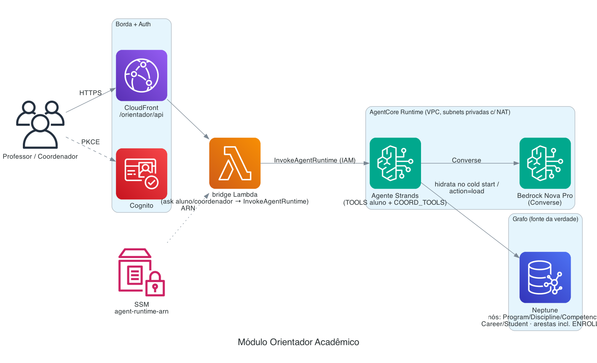

# Módulo Orientador Acadêmico

Orientador acadêmico sobre um **knowledge graph** (Amazon Neptune) com um **agente Strands** no
**Amazon Bedrock AgentCore Runtime**. Responde em PT-BR, **sempre com base no grafo** (nunca
alucina). Dois modos:

- **Aluno** — trilha personalizada, progresso, "posso pular X?", comparar carreiras, matrícula
  do semestre.
- **Coordenador** — perguntas que cruzam **todos os alunos/cursos**: alunos por curso/disciplina/
  competência/carreira, matrículas por disciplina, **grade de horários noturna** + nº de salas, e
  a **agenda de um aluno** específico.

> Este README reflete o sistema **em produção** (Neptune + AgentCore). O antigo protótipo local
> (NetworkX + CLI) evoluiu: o grafo agora é hidratado do **Neptune** e o agente roda no **AgentCore
> Runtime** dentro da VPC.

---

## Arquitetura



<sub>Diagrama como código: `docs/architecture/orientador.py` — regenere com `python3 docs/architecture/orientador.py`.</sub>

- O **browser nunca fala com o Runtime** — só o **bridge Lambda** (via IAM). Fronteira limpa.
- O agente hidrata um **grafo NetworkX em memória** a partir do Neptune no **cold start** (cache
  por container). `action=load` (re)carrega o Neptune a partir do dataset JSON embarcado na imagem.
- Se o Strands falhar, há **fallback determinístico** (`response_builder.answer_question`).

---

## Modelo de dados (grafo)

Nós: `Program`, `Discipline`, `Competency`, `Career`, `Student`.

| Relação | De → Para | Propriedades |
|---|---|---|
| `PREREQUISITE_OF` | Discipline → Discipline | `type` |
| `DEVELOPS_COMPETENCY` | Discipline → Competency | `weight` |
| `REQUIRES_COMPETENCY` | Career → Competency | `importance` |
| `COMPLEMENTS` | Discipline → Discipline | `reason` |
| `OFFERED_IN` | Discipline → Program | `requirement` (mandatory/elective) |
| `COMPLETED` | Student → Discipline | `grade, semester, year` |
| **`ENROLLED`** | Student → Discipline | — (**matrícula do semestre atual**) |

O aluno também carrega `program`, `current_semester`, `target_career` como propriedades escalares.
Dataset de demonstração: **6 cursos**, **52+ disciplinas**, **~40 alunos**, e **matrícula do
semestre** (`ENROLLED`, ~191 matrículas, média 4.8/aluno) gerada deterministicamente.

### Matrícula do semestre (ENROLLED)

Não há SIS real, então a matrícula é **gerada de forma determinística e coerente** por
[`gen_enrollment.py`](gen_enrollment.py): "em curso" = o **1º bloco do plano recomendado**
(`recommend_path`), respeitando currículo, pré-requisitos e semestre (máx. 5/semestre). Gravada em
`data/students.json` (campo `enrolled`) e ingerida como aresta `ENROLLED`. No menu **Alunos** o
aluno aparece em três baldes **disjuntos**: **Concluídas** / **Em curso** / **Faltantes**.

---

## Ferramentas do agente

**Modo aluno** (escopo em `CURRENT_STUDENT`): `progresso_aluno`, `minha_matricula`,
`recomendar_trilha`, `checar_prerequisito`, `comparar_carreiras`, `explicar_conexao`,
`gargalos_do_curso`, `lacunas_de_competencia`.

**Modo coordenador** (cruza todos os alunos): `alunos_do_curso`, `disciplinas_do_curso`
(com `matriculados_agora` + `já_cursaram`), `alunos_matriculados_por_disciplina`,
`matriculas_por_disciplina` (global), `montar_grade_noturna`, `grade_do_aluno`,
`alunos_por_disciplina`, `alunos_por_competencia`, `alunos_por_carreira`, `visao_geral_cursos`.

### Grade de horários (conflito-consciente)

`montar_grade_noturna` monta uma grade **a partir da matrícula real**: duas disciplinas com um
aluno em comum **nunca** caem no mesmo horário (grafo de conflito). Aloca balanceando a carga
para **minimizar salas**; parâmetros `noites`/`aulas_por_noite`. `grade_do_aluno` reaproveita a
**mesma** grade e filtra pela matrícula do aluno → agenda pessoal consistente.

### Anti-alucinação

Os prompts (aluno e coordenador) exigem responder **somente** com dados das ferramentas. O grafo
tem cursos/disciplinas/competências/carreiras/alunos + **concluídas** + **matrícula**; **não tem**
professores, salas, capacidade nem custos → para esses, o agente **recusa e fundamenta** (ex.:
para "quantos professores", usa o pico de aulas simultâneas como mínimo). Toda resposta sai em
**Markdown** (títulos, negrito, listas) para renderizar bem no chat.

---

## Estrutura

```
orientador-academico/
  agent/
    entrypoint.py     # AgentCore app: ações ask (aluno/coordenador), recommend, progress,
                      #  student, graph, stats, insights, curriculum, transfers, load…
                      #  SYSTEM (aluno) + COORD_SYSTEM (coordenador). Fallback determinístico.
    tools.py          # ferramentas Strands (TOOLS aluno + COORD_TOOLS coordenador)
    prompts.py  specialists.py  requirements.txt
  bridge/handler.py   # Lambda: /orientador/api/* → InvokeAgentRuntime (repassa student_id/mode)
  src/
    graph/            # builder (JSON→NetworkX), queries (traversals), neptune_store (ingestão),
                      #  neptune_client
    recommender/      # path_engine (trilha, what-if), insights (perfil, gargalos, grade…)
    llm/              # response_builder (fallback), bedrock_client
  data/               # dataset sintético (programs/disciplines/competencies/careers/students/relationships)
  gen_enrollment.py   # gera a matrícula do semestre (ENROLLED) em students.json
  Dockerfile          # imagem ARM64 do Runtime (uv + python -m agent.entrypoint via OTel)
  tests/              # pytest (grafo, queries, recomendador, insights) — sem Bedrock
```

---

## Deploy (AgentCore em VPC) — leia os gotchas

O agente roda no **AgentCore Runtime em VPC** (precisa alcançar o Neptune → **subnets privadas
com NAT**). Use [`../scripts/deploy-orientador-agent.sh`](../scripts/deploy-orientador-agent.sh):

```bash
# pré-requisito: CDK já implantado com -c modules=...,orientador (cria Neptune, role, SG, subnets, SSM, bridge)
./scripts/deploy-orientador-agent.sh
```

O script faz: build ARM64 (finch/docker) → push no ECR → **create/update-agent-runtime** (VPC) →
espera READY → publica ARN no SSM → `action=load` (recarrega o Neptune).

### Gotchas do AgentCore (aprendidos na marra)

- **O `agentcore` starter toolkit (v0.1.x) REMOVEU o suporte a VPC** (`configure/launch` forçam
  PUBLIC). Por isso **não usamos o toolkit** para deploy: buildamos a imagem e chamamos
  `bedrock-agentcore-control update-agent-runtime` direto, **reusando a networkConfiguration VPC**
  do runtime vivo (subnets/SG que já funcionam com NAT).
- **`requireServiceS3Endpoint` é imutável** para runtimes criados após 2026-06-11 → **remova esse
  campo** do `networkModeConfig` no update (senão `ValidationException`).
- **`runtimeSessionId` exige ≥ 33 caracteres** na invocação.
- **`action=load`** limpa e recarrega o Neptune (centenas de MERGEs) → **use `--cli-read-timeout`
  alto** (o default estoura); é idempotente, pode reinvocar.
- Mudança **só de código** do agente = rebuild + `update-agent-runtime` (não precisa recarregar o
  Neptune). Mudança **de dados** (ex.: nova matrícula) = rebuild + `update` + `action=load`.
- Rodar os builds/deploys do **build dir off-OneDrive** (o OneDrive trava operações de
  empacotamento/synth).

---

## Configuração (env do Runtime)

`NEPTUNE_ENDPOINT`, `ORIENTADOR_MODEL_ID` (`amazon.nova-pro-v1:0`), `AWS_REGION`. O bridge lê o ARN
do Runtime de um parâmetro **SSM** (publicado pelo deploy).

---

## Custos (referência, sujeito a mudança)

- **Fixo (ocioso):** **Amazon Neptune** é o maior driver (mesmo Serverless tem um mínimo de NCU
  de pé) — é o principal custo ocioso do módulo. AgentCore Runtime = US$ 0 ocioso (paga por
  invocação/duração).
- **Variável:** Bedrock **Nova Pro** por invocação do agente (tokens); barato por pergunta. A
  ingestão/`load` do Neptune é esporádica.

> Diferente de LMS/Avaliações (que são ~centavos parados), o Orientador tem **custo fixo de
> Neptune**. Se ficar ocioso, considere pausar/reduzir o cluster.

---

## Testes e utilitários locais

```bash
cd orientador-academico
.venv/bin/python -m pytest -q          # 42 testes (grafo, queries, recomendador, insights)
.venv/bin/python gen_enrollment.py     # regenera a matrícula do semestre (ENROLLED)
```
