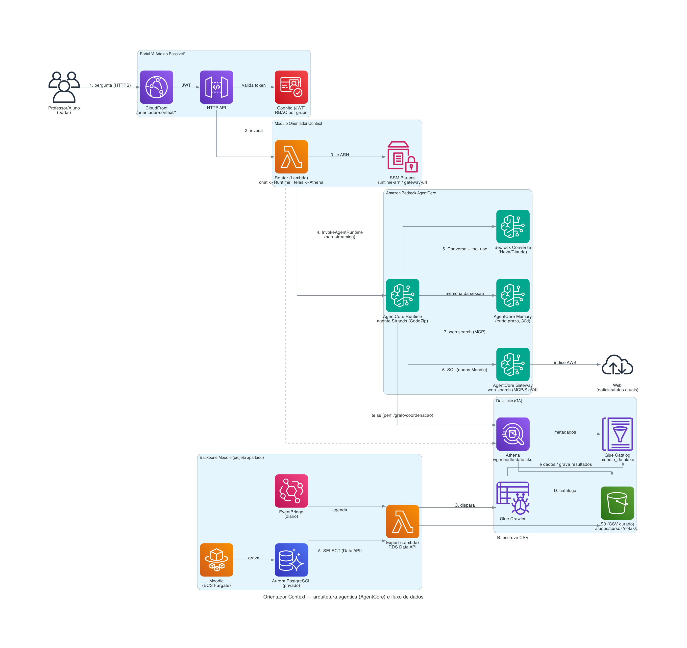

# Orientador Context

Módulo **novo e isolado** do portal "A Arte do Possível". É a Fase 3 da spec
`.kiro/specs/orientador-context/`: um orientador acadêmico que consome o **data lake do
Moodle** (backbone em projeto apartado) em vez de um grafo Neptune próprio.

> **Coexiste** com o **Orientador Acadêmico** atual (Neptune, `/orientador/*`) — nada dele é
> alterado. Este módulo é **inerte por padrão**: só é provisionado quando ativado por
> `-c modules=...,orientador-context`. O objetivo é provar o conceito lado a lado e, depois,
> aposentar o atual (Fase 5).

## Arquitetura (chat agêntico no AgentCore + telas determinísticas)

```
Navegador (portal) ──/orientador-context/*──► CloudFront ──► HTTP API + JWT (Cognito)
                                                                     │
                                                        Router (Lambda) — decide o caminho:
                                                                     │
        ┌────────────────────────────────────────────────────────────┴───────────────┐
        │ CHAT (/ask)                                       TELAS determinísticas       │
        ▼                                                   (perfil/grafo/coordenação)  │
  InvokeAgentRuntime (não-streaming)                                    │  Athena       │
        ▼                                                               ▼               │
  Amazon Bedrock AgentCore Runtime                    Glue Data Catalog `moodle_datalake` (S3)
  · agente Strands (CodeZip, sem VPC)                 (alunos, cursos, matriculas, notas, ...)
  · Bedrock Converse (Nova/Claude) + tool-use ──► SQL no Athena (mesmos dados do Moodle)
  · AgentCore Memory (curto prazo, por sessão)
  · AgentCore Gateway (web-search, MCP/SigV4) ──► índice web da AWS (notícias/fatos atuais)
```

O **chat** foi migrado para um **sistema agêntico de verdade**: um agente **Strands** hospedado
no **Amazon Bedrock AgentCore Runtime** (deploy **CodeZip**, sem Docker/VPC). O **Router
(Lambda)** apenas faz a **ponte** `HTTP → InvokeAgentRuntime` (não-streaming) — o browser
nunca fala com o Runtime; só a Lambda, com IAM próprio. As **telas determinísticas**
(perfil, trilha, grafo, coordenação, etc.) seguem consultando o data lake via **Athena direto**
na Lambda — mais simples e barato para dados tabulares fixos.

Capacidades do agente:
- **Dados do Moodle** — ferramentas que consultam o **data lake** via Athena (`moodle_datalake`),
  com RBAC por sessão. Responde só com base no retorno das ferramentas (anti-alucinação).
- **Notícias / eventos atuais** — **AgentCore Web Search** (conector gerenciado, MCP, servido
  dentro da AWS, sem chaves/egress) via **AgentCore Gateway** com auth **IAM/SigV4**. O agente
  cita as fontes (título, URL, data). **Só no perfil coordenação.**
- **Conhecimento geral** — responde direto pelo modelo. **Só no perfil coordenação.**
- **Escopo por perfil (RBAC):** o **aluno** fica restrito à vida acadêmica da universidade
  (dados do Moodle: desempenho, disciplinas, trilha, risco) — **sem web search e sem
  perguntas fora de escopo** (recusa educadamente e reorienta). Web search e conhecimento
  externo são exclusivos da **coordenação**. Reforçado nas duas pontas: a tool `web_search`
  só entra no toolset de coordenação **e** tem guarda interna `restrito a coordenacao`.
- **Memória de conversa** — **AgentCore Memory** (curto prazo, 30 dias) de verdade, via
  `AgentCoreMemorySessionManager` do Strands: o agente **persiste e recupera** os turnos no
  AgentCore Memory (por `session_id`/`actor_id` enviados pela ponte), sem depender do
  histórico do browser. Isso dá continuidade multi-turno **e** gera os spans nativos de
  memória (`CreateEvent`/`ListEvents`) no AgentCore Observability.

- **Sem VPC** (Athena/Glue/S3/Bedrock/AgentCore têm endpoints públicos) → mais simples que o
  Orientador atual (que precisa de VPC para o Neptune).
- **Modelos parametrizados** (`MODEL_ID`, default `amazon.nova-pro-v1:0`), nunca fixos no código.
- **Rollback seguro:** se o `InvokeAgentRuntime` falhar, o Router cai automaticamente no antigo
  agente-em-Lambda (Bedrock Converse local), sem derrubar o chat.

## Diagrama de arquitetura



> Fonte versionada em `docs/architecture/orientador-context.py` (lib `diagrams` + Graphviz).
> Re-render: `python3 orientador-context/docs/architecture/orientador-context.py`.

## Fluxo de dados (do Moodle ao chat)

São **dois fluxos** independentes: a **ingestão** (leva o dado do Moodle até o data lake) e a
**pergunta** (o chat consome o data lake em tempo real).

### Ingestão — Moodle → data lake (diária / sob demanda)
- **A. Extração:** o Moodle grava tudo no **Aurora PostgreSQL** (privado, sem IP público). Uma
  **Lambda de export** lê visões curadas via **RDS Data API** (HTTPS, sem VPC/driver),
  disparada por **EventBridge (diário)** ou sob demanda (`invoke`).
- **B. Escrita:** a Lambda grava um **CSV por dataset** no **S3** em `s3://.../moodle/<dataset>/`
  (alunos, cursos, matriculas, notas, competencias).
- **C. Catalogação:** ao terminar, a Lambda **dispara o Glue Crawler**.
- **D. Catálogo:** o crawler infere o schema e cria/atualiza as tabelas no **Glue Data Catalog**
  (database `moodle_datalake`), deixando-as consultáveis por SQL.

> O dado do Moodle vira tabelas SQL no data lake — **derivado e reproduzível** (reexecutar a
> export regenera os CSVs).

### Pergunta — chat agêntico (tempo real)
1. **Pergunta:** você digita no chat do portal; o navegador chama
   `https://<portal>/orientador-context/api/ask` (HTTPS) via **CloudFront**.
2. **Auth/roteamento:** o CloudFront encaminha à **HTTP API**, que valida o **JWT do Cognito**
   (o grupo — admin/professor vs aluno — define o **RBAC**) e invoca o **Router (Lambda)**.
3. **Ponte para o Runtime:** o Router lê o ARN do runtime no **SSM** e chama
   **`InvokeAgentRuntime`** (não-streaming), passando `question`, `mode`, `student_id`,
   `groups` e o histórico. Uma sessão estável por (usuário, modo, aluno) chaveia a **memória**.
4. **Raciocínio (agente Strands):** o **AgentCore Runtime** roda o agente, que via **Bedrock
   Converse + tool-use** decide o que usar:
   - **SQL no Athena** (workgroup `moodle-datalake`, sobre o Glue Catalog → CSVs no S3) para
     dados do Moodle — responde **só com base neles** (anti-alucinação);
   - **AgentCore Web Search** (via Gateway/MCP) para notícias/fatos atuais, **citando fontes**;
   - conhecimento geral do modelo quando cabe.
5. **Resposta:** o agente devolve a resposta completa ao Router, que a entrega ao chat. O RBAC
   é reforçado nas duas pontas (Router + agente): aluno é escopado ao próprio `student_id`;
   visões de coordenação exigem grupo `admin`/`professor`.

**Em uma frase:** o Moodle abastece um data lake (Aurora → Lambda → S3 → Glue); quando você
pergunta no chat, o Router aciona um agente Strands no **AgentCore Runtime** que combina SQL no
Athena (dados do Moodle), **web search** (atualidades) e memória de conversa — com o papel
(aluno/coordenador) imposto pelo Cognito.

## Ganho central vs o Orientador atual: RBAC

O Orientador atual não tem RBAC (qualquer logado "vira coordenador"). Aqui o papel vem dos
**grupos do Cognito** (claims do JWT):
- **Coordenador** (`admin`/`professor`): visões agregadas (desempenho por faculdade) e alunos
  em risco de evasão + **web search** e **conhecimento geral** (responde qualquer pergunta).
- **Aluno**: escopado ao próprio; as tools de aluno são **forçadas** ao `student_id` da sessão
  e as tools de coordenação retornam "acesso negado". **Escopo restrito ao acadêmico**: sem
  web search e sem perguntas fora do contexto da universidade (recusa e reorienta). (Com o AWS Context, a permissão passa a
  ser imposta no próprio dado.)

## Features (paridade com o Orientador Acadêmico, adaptada ao data lake)

Telas/menu (todas sob "Orientador Context"): **Alunos** (perfil + notas), **Cursos** (disciplinas
por faculdade com matriculados/média), **Chat** (agente Strands no AgentCore Runtime: dados do
Moodle + web search + memória, RBAC), **Trilha**
(a refazer/pendentes/concluídas + % conclusão), **Grafo** (SVG força-dirigido reaproveitado:
`Tudo` = faculdades×disciplinas, `Aluno` = aluno→disciplinas→competências), **Insights**
(risco de evasão, pontos fortes/fracos, recomendações), **Currículo** (faculdades +
disciplinas-ponte), **Competências** (matriz competência×faculdade), **Coordenação**
(alunos por faculdade + **grade noturna conflito-consciente**), **Risco de evasão**,
**Desempenho por faculdade**.

Ações do agente (rotas `/orientador-context/api/*`): `bootstrap, ask, perfil, progresso,
trilha, matricula, competencias-aluno, insights, grafo, programa, faculdades, curriculo,
curriculo-faculdade, competencias-matriz, risco, desempenho, visao-geral, alunos-curso,
matriculas-disciplina, alunos-disciplina, alunos-competencia, grade-noturna, grade-aluno`.

**Fora de escopo (sem dado no Moodle):** Carreiras / Direcionador de carreira, trilha por
pré-requisito / what-if e Insights de caminho-crítico (não há grafo de pré-requisito), e o
fluxo de transferência de curso (exigiria escrita/DynamoDB). Documentado como enriquecimento
futuro (a lógica de grade noturna, essa sim, foi portada por só depender da matrícula).

## Componentes

- `agent/handler.py` — **Router (Lambda)**: rotas HTTP + RBAC pelos grupos do Cognito. O
  `/ask` faz a **ponte** para o AgentCore Runtime (`InvokeAgentRuntime`, lendo o ARN no SSM),
  com **fallback** ao Converse local. As telas determinísticas seguem em Athena direto.
- `agent/tools.py` — consultas Athena sanitizadas usadas pelas telas determinísticas (e pelo
  fallback local) + specs do Converse.
- `agent/athena.py` — helper de consulta ao workgroup/database do data lake.
- `agent/prompts.py` — prompts (modo aluno/coordenação) com regra anti-alucinação.
- `runtime/agent.py` — **agente Strands** do AgentCore Runtime: `@app.entrypoint` +
  ferramentas Athena (perfil/progresso/trilha/cursos/desempenho/risco) com RBAC por sessão +
  `web_search` (AgentCore Gateway) + limpeza de saída. Modelo por `MODEL_ID`.
- `runtime/gateway-websearch.yaml` — CloudFormation do **AgentCore Gateway** (IAM/SigV4 +
  conector `web-search`). Sem account-id hardcoded (usa pseudo-parâmetros).
- `runtime/deploy-runtime.sh` — deploy reproduzível do runtime (CodeZip, sem Docker): gateway +
  `agentcore launch` + IAM least-privilege na execution role + SSM (`runtime-arn`, `gateway-url`).
- `infra/modules/orientador_context.py` — construct CDK (Lambda + HTTP API + Cognito + IAM
  least-privilege: Athena/Glue/S3/Bedrock/AgentCore/SSM escopados). Exposto no CloudFront sob
  `/orientador-context/*` por bloco aditivo em `infra/exam_stack.py`.
- Frontend: itens de menu **Orientador Context** e telas `octx-*` em `frontend/app.js`
  (helper `octxApi`) — puramente aditivo.

## Deploy (opt-in — não altera o deploy padrão)

O módulo consome o **DataLakeBucket** do stack do backbone (`moodle-backbone`, projeto
apartado). O `deploy.sh` resolve o bucket automaticamente quando o módulo é ativado:

```bash
# Ativa o módulo junto do conjunto atual (preserva os módulos que você já usa!):
MODULES="correcao,entrevistador,orientador-context" ./scripts/deploy.sh
```

> ⚠️ **Importante:** o CloudFormation reflete o ÚLTIMO conjunto de `modules` deployado. Informe
> em `MODULES` **todos** os módulos que devem seguir ativos (ex.: inclua `orientador,lms` se
> estiverem no ar) — omitir um o remove. Sem `MODULES`, o deploy segue idêntico ao atual.

Variáveis: `MOODLE_STACK` (default `moodle-backbone`) e `ORIENTADOR_CONTEXT_LAKE_BUCKET`
(override manual do bucket) e `orientadorContextModelId` (via `-c`).

## Verificação rápida (pós-deploy)

```bash
curl -s https://<cloudfront>/orientador-context/health          # {"ok":true,...}
# Chat (aluno):  POST /orientador-context/api/ask {question, mode:"aluno", student_id:"aluno0001"}
# Coordenação:   POST /orientador-context/api/desempenho   (exige grupo admin/professor)
```

## Observabilidade (nativa do AgentCore)

Tudo vai para o painel **CloudWatch → GenAI Observability** (aba *Bedrock AgentCore*), sem
métrica "na mão". A instrumentação é **automática**: o runtime é deployado pela AgentCore CLI
e o agente inclui **`aws-opentelemetry-distro`** (ADOT) no `requirements.txt`; com o
**Transaction Search** habilitado na conta, o dashboard mostra por agente/sessão/trace:

- **Consumo de tokens** — `gen_ai.usage.input_tokens` / `output_tokens` / `total_tokens` por
  invocação de modelo e acumulado por invocação do agente;
- **Latência** e **modelo** de cada chamada;
- **Tool-use** — spans `execute_tool` (ex.: `desempenho_faculdade`, `web_search`) e o laço
  do agente (`invoke_agent`, `execute_event_loop_cycle`);
- **Downstream** — spans das chamadas AWS (Athena, SSM) e do Gateway/web-search.

Os spans detalhados chegam no stream **`spans`** do log group
`/aws/bedrock-agentcore/runtimes/<runtime-id>-DEFAULT` (fonte do dashboard). Cobertura por
recurso do AgentCore (tudo nativo, verificado no stream `spans`):

- **Agente/modelo** — `invoke_agent Strands Agents`, `execute_event_loop_cycle`, `chat`
  (com `gen_ai.usage.*` = tokens in/out/total, modelo, latência).
- **Tools** — `execute_tool <nome>` (ex.: `desempenho_faculdade`, `web_search`) + as chamadas
  downstream `Athena.StartQueryExecution/GetQueryExecution/GetQueryResults` e `SSM.GetParameter`.
- **Memory** — `Bedrock AgentCore.CreateEvent` (grava turno) e `Bedrock AgentCore.ListEvents`
  (recupera a conversa); métricas de memória (Invocations/Latency/Errors/Creation) saem por
  padrão no namespace do recurso de Memory.
- **Gateway (web-search)** — `mcp.session`, `mcp tools/list`, `mcp tools/call
  web-search-tool___WebSearch`; o recurso de Gateway também emite métricas próprias.
- **Identity** — a auth é **IAM/SigV4** (não usamos credential provider/OAuth do AgentCore
  Identity, que não é necessário aqui); a identidade aparece nos atributos `aws.auth.*` das
  chamadas AWS. Se um dia integrarmos um provedor OAuth via AgentCore Identity, os spans
  desse fluxo passam a aparecer automaticamente.

Decisões que mantêm isso correto:

- **Não** inicializamos `StrandsTelemetry` no código — o ADOT já instrumenta; fazer os dois
  duplica os spans de inferência e **double-conta** tokens.
- O streaming da resposta pro stdout fica desligado (`callback_handler=None`) só para manter
  os logs limpos; não afeta a telemetria.

**Onde ver:** CloudWatch → *GenAI Observability* → *Bedrock AgentCore* → agente
`orientador_context` (Agents / Sessions / Traces). Para busca de spans: *Transaction Search*.

> Observação: **custo em USD não é calculado pelo painel nativo** (ele mostra tokens). Se
> precisar de custo monetário, dá pra derivar dos tokens (tabela de preços por modelo) — não
> implementado por padrão para não duplicar telemetria; ver a regra de EMF no steering.

## Estado — DEPLOYADO (deploy cirúrgico)

O módulo está **no ar** no portal, sob `/orientador-context/*`, com o chat já **agêntico**
(AgentCore Runtime). Verificado ponta a ponta: `/orientador-context/health` → 200; o **runtime**
responde com as notas/progresso reais do aluno via Athena (sem alucinar), com **web search**
citando fontes para notícias e **memória** multi-turno; `/desempenho` e `/risco` (telas) seguem
para coordenação; aluno recebe 403 nas rotas de coordenação (RBAC); rota autenticada sem token
→ 401. Os módulos existentes (`/api/*`, `/entrevistador/*`, `/orientador/*`, `/lms/*`) seguem
**intactos**. Se o runtime ficar indisponível, o Router cai no Converse local (rollback).

**Deploy do agente (AgentCore Runtime):** `cd orientador-context/runtime && ./deploy-runtime.sh`
— provisiona o Gateway (web search), faz `agentcore launch` (CodeZip, **sem Docker**), aplica
IAM least-privilege na execution role e publica os SSM params (`runtime-arn`, `gateway-url`)
que o Router consome. Reproduzível, sem account-id/bucket hardcoded (resolve dos stacks).

**Como foi deployado (e por que não pelo `deploy.sh`):** o `deploy.sh` faz `cdk deploy` do
portal inteiro, inviável neste ambiente — o módulo Entrevistador usa **imagem Docker**
(`ContainerImage.from_asset`) e o fingerprint de assets do CDK falha lendo o repositório no
OneDrive. Para não redeployar (nem arriscar) o portal, o deploy é **cirúrgico e reproduzível**,
versionado em **`orientador-context/deploy/`**: stack CDK standalone (Lambda + HTTP API +
Cognito importado + IAM least-privilege) + behavior `/orientador-context/*` ligado à
distribution existente de forma aditiva/idempotente + publicação do `app.js`. Um comando:

```bash
cd orientador-context/deploy && ./deploy.sh     # resolve IDs/bucket sozinho; NÃO requer Docker
```

> **Reconciliar para o CDK do portal (quando houver Docker):**
> `cd orientador-context/deploy && ./teardown.sh` (remove behavior + stack standalone) e depois
> `MODULES="correcao,entrevistador,orientador,lms,orientador-context" ./scripts/deploy.sh`
> (o `deploy.sh` já resolve o `DataLakeBucket`). Enquanto o portal não é redeployado com a flag,
> o módulo vive pelo caminho cirúrgico acima.

## Próximo (spec Fase 4/5)

Comparação lado a lado com o Orientador atual (acurácia/custo/governança); **AgentCore
Observability** para traces do agente (tokens/custo/latência) e **AgentCore Evaluations**
(online/batch + A/B) alimentadas por esses traces; e, quando o AWS Context liberar, plugar a
busca governada sobre o mesmo data lake. Memória de longo prazo (LTM) é evolução natural da
STM já provisionada.
