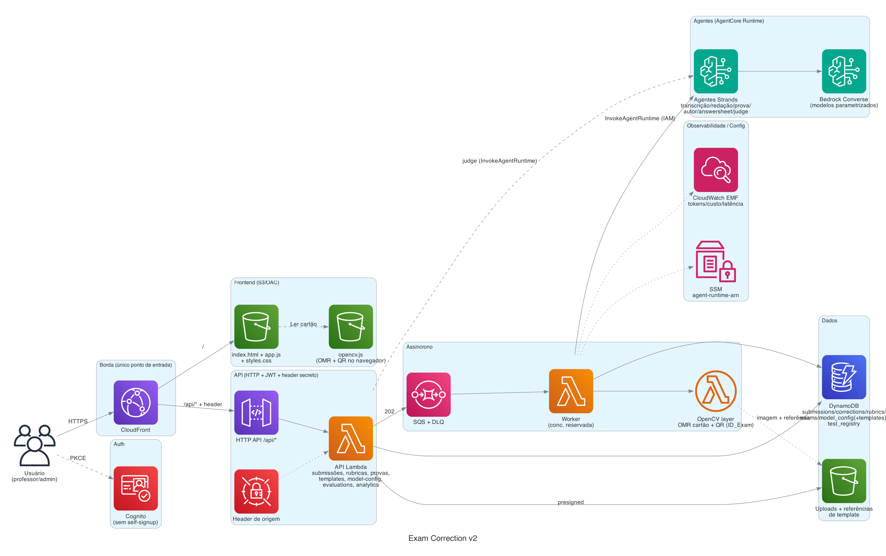

# Exam Correction v2

Plataforma serverless de **leitura e correção de provas** assistida por IA, em **PT-BR**.

Correção de material enviado (imagem/PDF), em três tipos:

- **Redação** — correção por rubricas (padrão ENEM), nota por critério + feedback.
- **Prova discursiva** — correção por questão via **gabarito** ou conhecimento do modelo.
- **Cartão-resposta (múltipla escolha)** — leitura das marcações por **OMR determinístico
  (OpenCV)**, no navegador e no servidor, com detecção de **QR (ID_Exam)**.

E um módulo de **estudo** que fecha o ciclo criar → responder → corrigir → estudar:

- **Provas Online** — gera provas (múltipla escolha ou discursivas) ancoradas numa
  **Knowledge Base do Bedrock (RAG)**, o aluno responde no navegador e a correção é
  automática (MC **determinística**; discursiva por **LLM**). Para as questões erradas,
  sugere trechos das apostilas do KB (com a página) para revisão.

Os agentes são **Strands** hospedados no **Amazon Bedrock AgentCore Runtime**; os modelos
são chamados via **Bedrock Converse**, parametrizados por capacidade. Tudo atrás do
**CloudFront**, autenticado por **Cognito**.

Ordem de prioridade do projeto: **simplicidade → serverless → segurança → custo**.

---

## Arquitetura



```
Browser ─HTTPS─> CloudFront
                  ├── /            → S3 (frontend estático: index.html/app.js/styles.css
                  │                      + opencv.js p/ OMR e QR no navegador; OAC)
                  └── /api/*       → API Gateway HTTP (JWT Cognito + header secreto)
                                       └── Lambda API (CRUD + ciclo de vida + judge síncrono
                                             │            + geração/estudo de Provas Online)
                                             ├── DynamoDB / S3 (uploads + referências, presigned)
                                             ├── Bedrock Knowledge Base (bedrock:Retrieve) ── RAG p/ Provas Online
                                             └── SQS ─> Lambda Worker (concorrência reservada)
                                                          ├── OpenCV (layer): OMR do cartão + QR
                                                          ├── correção de tentativa online (MC/discursiva)
                                                          └── InvokeAgentRuntime (IAM)
                                                                └── AgentCore Runtime (agentes Strands)
                                                                      └── Bedrock Converse (modelos parametrizados)
```

- **Correção é assíncrona (job-based):** `upload → 202 + submissionId → polling`. Sem streaming.
  As tentativas de Provas Online também são corrigidas de forma assíncrona (worker).
- **O browser nunca chama o Runtime** — apenas o worker, via IAM. Fronteira de segurança limpa.
- **Modelos nunca são hardcoded** — escolhidos por capacidade na tela de Configuração de Modelos.
- **Knowledge Base (RAG):** só a **API** acessa o KB — na geração das provas e na sugestão de
  estudo. Configurada por contexto do CDK (`kbId`/`kbBucket`), não fica no bundle do frontend.

Detalhes de subsistemas (cartão/OMR, model-as-judge, seleção de modelos): [`docs/ARCHITECTURE.md`](docs/ARCHITECTURE.md).
Fonte da verdade do spec: `.kiro/specs/exam-correction-v2/`.

---

## Funcionalidades

Menu lateral (responsivo; vira gaveta no celular):

- **Prova Discursiva**: Correção · Criação (com wizard de resposta) · Histórico.
- **Redação**: Rubricas (CRUD versionado) · Correção · Histórico.
- **Prova Objetiva (cartão-resposta)**:
  - **Carregar cartão** — leitura **no servidor** (OMR OpenCV), suporta **upload em massa**.
  - **Ler cartão (OpenCV)** — leitura **no navegador** (opencv.js): reconhece a folha
    (features + homografia → corrige posição/rotação/zoom/perspectiva), lê as marcações,
    permite correção manual e salva no histórico.
  - **Templates** — editor visual: sobe a imagem-demo, desenha/edita blocos (mover e
    redimensionar), define alternativas e sensibilidade por bloco; wizard de auto-detecção.
  - **Histórico**.
- **Provas Online** (módulo de estudo, ancorado na Knowledge Base):
  - **Provas** — gera uma prova a partir de um **tema/disciplina** do KB, escolhendo formato
    (**múltipla escolha** ou **discursiva**) e nº de questões. Admin pode reindexar os temas
    do KB (↻ Atualizar temas). Cada questão fica ancorada em trechos do material.
  - **Teste de prova** — responde a prova no navegador; ao enviar, a correção roda no worker
    (MC determinística; discursiva por LLM) e o resultado aparece no histórico.
  - **Histórico** — tentativas com nota/acertos e, por questão errada, **sugestão de estudo**
    (trecho da apostila do KB + página + link de download do documento).
- **Configuração › Modelos**: primário/challenger por capacidade + modo (desligado / A-B por
  % / ambos) + preços por modelo.
- **Analytics**: Dados Analíticos (notas, tokens/custo por modelo, **provas/tentativas
  online**) e **Evaluation** (model-as-judge — compara saídas de modelos diferentes e aponta
  a melhor, com notas por dimensão; avaliações ficam salvas).
- **QR / ID_Exam**: ao carregar qualquer imagem (redação/prova/cartão), um QR code é lido e
  seu conteúdo salvo em `ID_Exam`, exibido nas listas e detalhes do histórico.
- **👍/👎** por transcrição e por correção no histórico (insumo para a Evaluation/analytics).

---

## Pré-requisitos

- Conta AWS com acesso ao Amazon Bedrock e ao Bedrock AgentCore na região de deploy.
- **Credenciais via `aws configure` / AWS SSO** (nunca chaves estáticas no repositório).
- **Node 20+** (CDK CLI), **Python 3.12**, **AWS CLI v2**, **Graphviz** (só para regenerar o diagrama).
- **Model access** habilitado no console do Bedrock, na região de deploy: o(s) modelo(s) de
  chat/visão (ex.: Claude Sonnet) **e** o **Titan Text Embeddings V2**
  (`amazon.titan-embed-text-v2:0`) se for usar o KB (Provas Online). Sem isso,
  transcrição/correção e o KB falham em runtime.
- `pip install bedrock-agentcore-starter-toolkit strands-agents` (deploy dos agentes).
- **Só para o módulo Provas Online:** uma **Amazon Bedrock Knowledge Base**. Você pode:
  - **Provisionar o KB de demonstração** (acervo sintético já incluído no repo) com
    `DEPLOY_KB=1 ./scripts/deploy.sh` — cria bucket, sobe o conteúdo, cria o KB (S3 Vectors)
    e ingere. **É conteúdo sintético, só para demonstração** (ver `assets/kb-demo/README.md`); ou
  - **Apontar para um KB próprio** já criado e **sincronizado**, informando `KB_ID`/`KB_BUCKET`.

  Sem KB, os demais fluxos (redação, discursiva, cartão) funcionam normalmente; apenas
  Provas Online fica indisponível. Formato esperado do acervo:
  [Provas Online (Knowledge Base)](#provas-online-knowledge-base).

---

## Configuração (`.env`)

```bash
cp .env.example .env   # preencha; o .env real é ignorado pelo git
```

| Variável | Descrição |
|----------|-----------|
| `AWS_REGION` | Região de deploy (padrão `us-east-1`). |
| `STACK_NAME` | Nome da stack CDK. |
| `WORKER_CONCURRENCY` | Concorrência reservada do worker (limita chamadas simultâneas ao Bedrock). |
| `DEFAULT_MODEL_ID` | Opcional. Semeia todas as capacidades; vazio = configurar pela UI. |
| `BOOTSTRAP_ADMIN_EMAIL` | E-mail do 1º admin (opcional; pode passar no script). |
| `DEPLOY_KB` | `1` = provisiona o KB de demonstração (acervo sintético) no deploy. Padrão `0`. |
| `KB_ID` / `KB_BUCKET` | Apontar para um KB **próprio** (em vez do demo). Vazio = usa `DEPLOY_KB` ou desabilita Provas Online. |

**Nunca** coloque `AWS_ACCESS_KEY_ID`/`SECRET` no `.env` versionado. Use profile/SSO.

---

## Deploy

**Um comando faz tudo.** Preencha o `.env` e rode:

```bash
DEPLOY_KB=1 BOOTSTRAP_ADMIN_EMAIL=admin@suaescola.edu.br ./scripts/deploy.sh
```

`deploy.sh` executa, **numa ordem só**:

1. **Layer OMR** (`build-omr-layer.sh`, se `BUILD_OMR_LAYER=1`) — publica a layer OpenCV num
   bucket de staging próprio e grava o ARN em `infra/omr-layer.json`.
2. **KB de demonstração** (`deploy-kb.sh`, se `DEPLOY_KB=1`) — ver abaixo.
3. **CDK** (stack única + `OriginSecret`), passando `omrLayerArn`/`kbId`/`kbBucket` por contexto.
4. **Cognito** (callback/logout URLs), **CORS** do bucket de uploads, **seed** (rubrica ENEM +
   model_config), publicação do **frontend** e deploy dos **agentes** (`deploy-agents.sh`).
5. **1º admin** (se `BOOTSTRAP_ADMIN_EMAIL` definido).

Tudo é **opcional e desacoplado**: sem `BUILD_OMR_LAYER` o OMR server-side é pulado (leitura de
cartão no navegador segue funcionando); sem KB, o módulo Provas Online fica indisponível; os
demais fluxos funcionam. Nada de ARN/bucket/conta hardcoded — cada peça se auto-provisiona.

`deploy-kb.sh` (chamado quando `DEPLOY_KB=1`, ou avulso) provisiona o **KB de demonstração**:
cria o bucket de origem, sobe o **acervo sintético** de `assets/kb-demo/`, cria o vector store
(**Amazon S3 Vectors**), o Knowledge Base (embeddings Titan v2) + data source e dispara a
ingestão. Grava `infra/kb-config.json` (`kbId`/`kbBucket`), lido pelo `deploy.sh`. **É conteúdo
sintético só para demonstração** — em produção, defina `KB_ID`/`KB_BUCKET` do seu KB real.

`build-omr-layer.sh` empacota `opencv-python-headless` + `numpy` (wheels manylinux, sem
Docker), publica a layer via um **bucket de staging próprio** e grava o ARN em
`infra/omr-layer.json` — que o `deploy.sh` passa ao CDK por contexto. **Não é preciso editar
ARN em código.**

> Deploys incrementais de código usam `aws lambda update-function-code` + `aws s3 sync` +
> invalidação do CloudFront (evita rotacionar o `OriginSecret` a cada `cdk deploy`).

### Configurar modelos e templates (pós-deploy)

1. **Configuração › Modelos**: defina o modelo primário por capacidade (`transcription`,
   `essay`, `exam`, `author`, `answersheet`, `examgen`) e, opcionalmente, challenger + A/B %.
   O `examgen` gera as Provas Online; a correção discursiva dessas provas reutiliza a
   capacidade `exam`.
2. **Prova Objetiva › Templates**: crie um template do seu cartão (imagem de referência +
   blocos + alternativas + sensibilidade). Necessário para o OMR (cliente e servidor).
3. **Provas Online (Knowledge Base):** já provisionado se você rodou `DEPLOY_KB=1` (acervo
   demo) ou informou `KB_ID`/`KB_BUCKET` (KB próprio). Os temas são lidos dos metadados
   (`*.pdf.metadata.json`, campo `disciplina`) sob `KB_THEMES_PREFIX`. Sem KB configurado, o
   módulo Provas Online fica indisponível — os demais fluxos seguem funcionando.

---

## Como usar cada módulo

Acesse o app pela URL do CloudFront, faça login (Hosted UI do Cognito) e use o menu lateral.

### Redação
1. **Redação › Rubricas** — crie/edite a rubrica (ou use a **ENEM** já semeada). Versionada.
2. **Redação › Correção** — envie a foto/scan da redação e escolha a rubrica. A submissão é
   assíncrona (`202`); acompanhe o status.
3. **Redação › Histórico** — abra o resultado: nota por critério + feedback, transcrição,
   imagem original e `ID_Exam` (se houver QR). Avalie a correção com **👍/👎**.

### Prova discursiva
1. **Prova Discursiva › Criação** (admin) — crie a prova; o **wizard** sugere respostas de
   referência (gabarito) por questão.
2. **Prova Discursiva › Correção** — envie a prova e escolha corrigir por **gabarito** ou por
   **conhecimento do modelo**. Assíncrono.
3. **Prova Discursiva › Histórico** — nota por questão + justificativa; 👍/👎.

### Prova objetiva (cartão-resposta)
1. **Prova Objetiva › Templates** (admin) — suba a imagem de referência do cartão, desenhe os
   blocos (1ª questão, nº de questões, alternativas), ajuste a sensibilidade. Necessário p/ o OMR.
2. **Ler cartão (OpenCV)** — leitura **no navegador**: alinha, lê as marcações, permite
   correção manual e salva. Ideal para conferência unitária.
3. **Carregar cartão** — leitura **no servidor** (requer a layer OMR); aceita **lote**.
4. **Histórico** — marcações por questão; QR/`ID_Exam` quando presente.

### Provas Online (estudo, requer KB)
1. **Provas Online › Provas** — escolha um **tema** (disciplina do KB), o **formato**
   (múltipla escolha ou discursiva) e o nº de questões; gere. (Admin pode **↻ Atualizar temas**.)
2. **Provas Online › Teste de prova** — responda no navegador; ao enviar, a correção roda
   (MC determinística / discursiva por LLM).
3. **Provas Online › Histórico** — nota/acertos e, nas questões erradas, **sugestão de estudo**
   (trecho da apostila do KB + página + download).

### Administração e análise
- **Configuração › Modelos** (admin) — modelo primário/challenger por capacidade, modo
  (desligado / A-B por % / ambos) e preços. Nada é hardcoded.
- **Analytics › Dados Analíticos** — notas, tokens/custo por modelo, provas/tentativas online.
- **Analytics › Evaluation** — model-as-judge: compara saídas de modelos e aponta a melhor.
- **Usuários** (admin) — criação de usuários (`admin`/`professor`); sem self-signup.

---

## API (resumo)

Todas as rotas sob `/api` (mesma origem do CloudFront; JWT Cognito obrigatório).

| Método | Rota | Descrição |
|--------|------|-----------|
| POST | `/submissions` | Cria submissão + URL pré-assinada (essay/exam/answersheet) |
| POST | `/submissions/{id}/confirm` | Valida upload e enfileira (202) |
| GET | `/submissions[/{id}]` | Histórico / estado + resultado (inclui `idExam`) |
| DELETE | `/submissions/{id}` | Apaga a submissão (correções + imagem S3 + registro) |
| GET | `/submissions/{id}/corrections` | Correções + transcrições da submissão |
| GET | `/submissions/{id}/image` | URL pré-assinada da imagem original |
| PUT | `/submissions/{id}/transcription-rating` | 👍/👎 de transcrição |
| POST | `/submissions/{id}/answersheet-result` | Salva leitura OMR feita no navegador (+`idExam`) |
| PUT | `/corrections/{id}/rating` | 👍/👎 de correção |
| GET/POST/PUT/DELETE | `/card-templates[/{id}]` | Templates de cartão |
| POST/GET | `/card-templates/{id}/reference` | Upload/leitura da imagem de referência (S3) |
| GET/POST | `/evaluations/candidates`, `/evaluations/run` | Model-as-judge |
| GET/POST | `/online-exams` | Lista / gera prova online (KB + `examgen`) |
| GET/DELETE | `/online-exams/{id}` | Detalhe (`?full=1` = com gabarito, p/ dono) / excluir |
| POST | `/online-exams/{id}/attempts` | Envia respostas → enfileira correção (202) |
| GET/POST | `/online-exams/themes` | Lista temas do KB / reindexa do S3 (admin) |
| GET | `/online-exams/kb-doc?uri=` | URL de download de uma apostila do KB |
| GET/DELETE | `/online-attempts[/{id}]` | Histórico de tentativas / detalhe / excluir |
| POST | `/online-attempts/{id}/study` | Sugere material de estudo (KB) para uma questão |
| GET/POST/PUT | `/rubrics[/{id}]`, `/exams[/{id}]` | Versionados (escrita = admin) |
| POST | `/exams/{id}/suggest-answer` | Wizard de resposta (admin) |
| GET/PUT | `/model-config[/{capability}]`, `/pricing` | Seleção de modelos e preços |
| GET | `/models` | Modelos multimodais disponíveis (ativos, sem duplicatas) |
| POST/GET | `/test-registry[/{testId}]` | Vínculo TestID ↔ dono (QR sem PII) |
| GET | `/analytics` | Métricas reais (DynamoDB + CloudWatch) |
| POST | `/admin/users` | Criar usuário (admin) |
| GET | `/health` | Health check |

---

## Cartão-resposta (OMR)

Dois caminhos com o **mesmo algoritmo** (alinhamento por features + threshold + medição de
preenchimento por bolha), a partir de um **template**:

- **Ler cartão (navegador, opencv.js):** feedback imediato, correção manual, salva no
  histórico. Ideal para conferência unitária.
- **Carregar cartão (servidor, layer OpenCV no worker):** processa via fila; aceita **vários
  arquivos** (lote). Ideal para volume.

O template guarda a geometria (blocos: 1ª questão, nº de questões, alternativas, retângulo
normalizado), a **sensibilidade** e uma **imagem de referência** (no S3). O alinhamento por
homografia (ORB) torna a leitura robusta a foto torta/descentralizada/com zoom. Marcações:
letra (A–E), `-` (em branco, vermelho), `*` (múltiplas, amarelo, com as letras detectadas).
Um **QR** na imagem é lido e salvo em `ID_Exam`.

---

## Provas Online (Knowledge Base)

Módulo de **estudo** que fecha o ciclo criar → responder → corrigir → estudar, ancorado numa
**Amazon Bedrock Knowledge Base** (conteúdo já indexado/embedado).

### Pré-requisito: o que precisa haver no KB

O módulo **exige** uma Knowledge Base criada e **sincronizada** antes do uso. O acervo
(bucket S3 de origem do KB) segue estas convenções:

- **Material em PDF** sob o prefixo configurado em `KB_THEMES_PREFIX`
  (padrão `privado/graduacao/eng-software/`). Por convenção de nome:
  - `*_material.pdf` — **apostila de conteúdo**; é o que as **sugestões de estudo** priorizam.
  - `*_email.pdf` — comunicados/e-mails; **excluídos** da geração e do estudo (não são material).
  - demais PDFs (ex.: ementa/plano) — entram na recuperação, mas **não** são priorizados no estudo.
- **Sidecar de metadados** por documento: um arquivo `<nome>.pdf.metadata.json` ao lado do PDF,
  no formato do Bedrock, com os atributos usados para listar os **temas** (disciplinas):

  ```json
  {
    "metadataAttributes": {
      "tipo": "disciplina",
      "modalidade": "graduacao",
      "curso_id": "eng-software",
      "disciplina": "Arquitetura de Software",
      "semestre": "4",
      "tipo_documento": "material",
      "is_apostila": true
    }
  }
  ```

  O código usa `disciplina` (vira o **tema** selecionável na tela), `semestre` (ordena a
  lista) e `curso_id`; os demais atributos são informativos. Documentos sem `disciplina`
  não aparecem como tema.
- A KB deve estar **em estado sincronizado** (ingestion job concluído) para o
  `bedrock:Retrieve` devolver passagens. A página de cada trecho vem do metadado
  `x-amz-bedrock-kb-document-page-number` (usada nas sugestões de estudo).

### Provisionamento

- **Demo (recomendado para experimentar):** o repo já inclui um **acervo sintético** em
  `assets/kb-demo/` (40 disciplinas fictícias de Engenharia de Software). Rode
  `DEPLOY_KB=1 ./scripts/deploy.sh` (ou `./scripts/deploy-kb.sh` avulso) para criar o bucket,
  subir o conteúdo, criar o KB (S3 Vectors + Titan v2) e ingerir. **Conteúdo sintético, só
  para demonstração — sem compromisso com qualidade pedagógica** (ver `assets/kb-demo/README.md`).
- **KB próprio (produção):** defina `KB_ID`/`KB_BUCKET` do seu Knowledge Base já criado e
  sincronizado, seguindo as convenções de nome/metadados acima. Passados ao CDK como
  contexto (`kbId`/`kbBucket`) pelo `deploy.sh`.

### Fluxo

1. **Gerar** (`POST /online-exams`): a API recupera trechos do KB por tema
   (`bedrock:Retrieve`) e o agente `examgen` cria as questões **fundamentadas apenas nesses
   trechos** — **múltipla escolha** (com gabarito + explicação) ou **discursivas** (com
   resposta de referência). Os temas vêm dos metadados do KB (campo `disciplina`).
2. **Responder** (`POST /online-exams/{id}/attempts`): a tentativa entra como `PROCESSING` e
   é enfileirada. A prova enviada ao aluno **não** inclui gabarito.
3. **Corrigir (worker, assíncrono):** múltipla escolha é **determinística** (marcada × correta);
   discursiva usa a capacidade **`exam`** (LLM) para nota + justificativa por questão.
4. **Estudar:** para questões erradas/fracas, sugere trechos das **apostilas** do KB com a
   **página** e link de download (`GET /online-exams/kb-doc`). E-mails (`*_email.pdf`) são
   excluídos do acervo de estudo; apostilas (`*_material.pdf`) têm prioridade.

Só a **API** acessa o KB (geração + estudo). O worker apenas corrige e grava o resultado da
tentativa. Provas e tentativas ficam em tabelas próprias (`online-exams`/`online-attempts`).

---

## Custos

O custo se divide em **fixo (ocioso)** — o que roda mesmo sem uso — e **variável (por uso)**,
dominado por **tokens de LLM (Bedrock)** na correção. Tudo serverless/pague-pelo-uso.

### Baseline ocioso (mensal, sem uso)

| Item | Estimativa (`us-east-1`) | Observação |
|---|---|---|
| Secrets Manager (`OriginSecret`) | ~US$ 0,40/mês | 1 segredo. |
| DynamoDB (on-demand + PITR) | centavos | Sem provisionamento; PITR cobra backup proporcional. |
| S3 (frontend, uploads, kb-source, staging, vector bucket) | centavos | Acervo demo ~1,4 MB; layer ~50 MB. |
| S3 Vectors (índice do KB demo) | centavos | Índice pequeno; cobra armazenamento + queries. |
| CloudFront, Cognito, SQS, SSM, Lambda (conc. reservada) | ~US$ 0 / free tier | Concorrência reservada não cobra ocioso. |
| AgentCore Runtime | US$ 0 ocioso | Consumo puro — só paga quando invocado. |
| **Total ocioso** | **≈ US$ 1–3/mês** | **Sem WAF** (removido neste projeto de teste). |

> Em produção, um **WAF WebACL** adicionaria ~US$ 5/mês + ~US$ 1/regra. Aqui foi removido de
> propósito por ser ambiente de teste.

### Custo variável (por uso)

- **Maior driver — tokens de LLM (Bedrock):** correção de redação/discursiva, transcrição,
  geração de provas (`examgen`) e judge. Medido nas Analytics por modelo. Escolha modelo forte
  só onde precisa; econômico no resto.
- **Embeddings (Titan v2):** na ingestão do KB (uma vez) + a cada Retrieve das Provas Online. Barato.
- **AgentCore Runtime:** duração/invocação dos agentes.
- **Lambda + API Gateway + SQS + DynamoDB on-demand:** centavos por milhares de requisições.
- **Cartão-resposta (OMR):** determinístico, **sem LLM** — só CPU do worker (ver abaixo).

O grande diferencial da correção de **cartão-resposta** é ser **determinística (OpenCV), sem
LLM**: não há custo de tokens/Bedrock — só serviços serverless por uso. O custo marginal é
dominado pelo tempo de CPU do worker.

### Corrigir 1.000 cartões (caminho "Carregar cartão", servidor)

Premissas: `us-east-1`, sob demanda, fora do free tier. Worker de **1 GB** por **~3 s** por
cartão (decodifica + alinha por features + lê bolhas + QR). Sem Bedrock, sem AgentCore.

| Serviço | Uso p/ 1.000 cartões | Custo aprox. |
|---|---|---|
| Lambda worker (OMR) | 1.000 × 3 GB-s = 3.000 GB-s | ~US$ 0,050 |
| Lambda API (create/confirm/polling) | ~4k invocações curtas | ~US$ 0,004 |
| API Gateway HTTP | ~4k requisições | ~US$ 0,004 |
| SQS | ~1k mensagens | ~US$ 0,001 |
| DynamoDB (on-demand) | ~4k escritas + leituras | ~US$ 0,006 |
| S3 (PUT/GET + ~200 MB/mês) | 1k upload + 1k leitura | ~US$ 0,010 |
| CloudFront (APIs pequenas) | ~4k req | ~US$ 0,005 |
| **Bedrock / LLM / AgentCore** | **não usado** | **US$ 0,00** |
| **Total marginal** | **1.000 cartões** | **≈ US$ 0,08–0,20** |

Ou seja, **~US$ 0,0001 por cartão** — praticamente desprezível, e escala linearmente.

- **Comparação com leitura por LLM (multimodal):** ler um cartão denso por LLM custaria da
  ordem de **~US$ 0,02–0,04 por cartão** (tokens de entrada+saída), ~**US$ 20–40 por 1.000**.
  O OMR determinístico é **~200–400× mais barato** — e mais confiável para grades.
- **"Ler cartão" (navegador):** o OMR roda no cliente (CPU do usuário, grátis); sobra só
  upload S3 + 1–2 chamadas de API + 1 escrita no Dynamo → **~US$ 0,02 por 1.000**.

Em baixa escala, o **free tier** do Lambda (1M req + 400k GB-s/mês) tende a zerar o custo
variável de vários milhares de cartões. O baseline ocioso mensal é o da tabela acima
(~US$ 1–3/mês, sem WAF).

> Preços de referência (`us-east-1`, sob demanda) e sujeitos a mudança — confira a
> [calculadora AWS](https://calculator.aws) para números oficiais. Correção de **redação** e
> **prova discursiva** usa LLM e tem custo por tokens (medido nas Analytics, por modelo).

---

## Licenças de terceiros

As dependências (OpenCV, NumPy, boto3, Pydantic, Strands, AgentCore, CDK etc.) e suas
licenças estão em [`THIRD-PARTY-NOTICES.md`](THIRD-PARTY-NOTICES.md). Destaque: o
`opencv-python-headless` embarca componentes de terceiros, incluindo **FFmpeg (LGPL-2.1+)**;
o OpenCV.js é servido ao navegador sob **Apache-2.0**.

---

## Segurança (Well-Architected)

- **Ponto de entrada único no CloudFront**; S3 via **OAC** + Block Public Access; API só
  aceita tráfego com o **header secreto** injetado pelo CloudFront; HTTPS obrigatório.
  (Projeto de teste **sem WAF** — em produção, adicione um WAF WebACL com regras
  gerenciadas + rate limiting.)
- **Cognito** sem self-signup, senha forte, MFA opcional, grupos `admin`/`professor`.
- **IAM de privilégio mínimo** por Lambda; **Runtime só acessível via IAM** pelo worker.
- Criptografia em repouso (S3/DynamoDB/SQS) e em trânsito. Segredos no Secrets Manager/SSM.
- **PII fora do QR** (apenas `testId`/`ID_Exam` de vínculo).

---

## Testes

```bash
python3 -m pytest -q          # lógica portável (prompts, schemas, A/B, custo, rubrica)
cd infra && cdk synth         # valida a infraestrutura
python3 docs/architecture/exam-correction-v2.py   # regenera o diagrama (requer Graphviz)
```

---

## Fases

- **Fase 1 (implementada):** auth, dados, borda segura, fila assíncrona, agentes no Runtime
  (transcrição, redação, prova, autor), rubricas, criação de prova + wizard, TestID/QR,
  métricas + analytics, seleção de modelos + A/B, frontend com menu lateral.
- **Fase 2 (implementada nesta versão):** **cartão-resposta** (OMR OpenCV no cliente e no
  servidor, templates, QR/ID_Exam, upload em massa), **Evaluation (model-as-judge)** e
  **👍/👎** no histórico.
- **Provas Online (implementada nesta versão):** módulo de estudo com **Knowledge Base
  (RAG)** — geração de provas (múltipla escolha e discursivas), aplicação no navegador,
  correção assíncrona (MC determinística / discursiva por LLM) e sugestão de estudo por
  questão errada.
- **Futuro:** **AgentCore Evaluations** nativo (online/shadow + batch) e uso das marcas de
  âncora do cartão (fiducial) para robustez máxima de OMR.

---

## Estrutura

```
infra/            # CDK (stack única): Cognito, S3, DynamoDB, SQS+DLQ, 2 Lambdas, HTTP API, CloudFront, Runtime
backend/
  common/         # lógica compartilhada (gabarito, rubrica ENEM, metrics, http, model_config, ids,
  #                 online_grading: helpers de KB/RAG + correção de tentativa online)
  api/            # router único da API (submissions, rubrics, exams, templates, evaluations,
  #                 model-config, analytics, online-exams/online-attempts)
  worker/         # worker SQS (ponte → Runtime) + omr.py (OpenCV: leitura de cartão + QR)
                  #  + correção assíncrona das tentativas de Provas Online
agents/           # agentes Strands (transcription/essay/exam/author/answersheet/judge/examgen)
frontend/         # SPA vanilla: index.html + app.js + styles.css (+ opencv.js hospedado)
assets/kb-demo/   # acervo SINTÉTICO do KB (Provas Online) — só para demonstração
scripts/          # deploy.sh, deploy-agents.sh, deploy-kb.sh, build-omr-layer.sh, create-admin-user.sh, seed.py
docs/architecture # diagrama como código (diagrams) + PNG
tests/            # pytest
```
