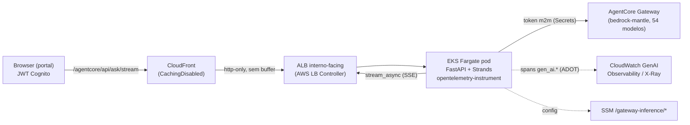

# Gateway Inference — backend no EKS Fargate (streaming SSE)

Backend do módulo **AgentCore → Gateway Inference** rodando no **Amazon EKS Fargate**
(cluster `strands-obs-demo`, us-east-1), com **streaming token-a-token via SSE** e
**observability nativa** (spans `gen_ai.*` no CloudWatch GenAI Observability / X-Ray).

## Problema real

Professores/coordenadores precisam de um chat que **responde progressivamente** (como um
assistente de verdade), não um spinner que trava até a resposta inteira chegar. O caminho
anterior (AgentCore Runtime + Lambda atrás de API Gateway) **bufferiza** a resposta — não há
SSE. Um pod vivo atrás de um ALB mantém a conexão aberta e **streama** os deltas. Foi por
isso que validamos a PoC de EKS no Fargate.

## Por que EKS/Fargate (e não Lambda)

- **API Gateway + Lambda** entregam a resposta em bloco (sem streaming incremental).
- **EKS Fargate**: pod FastAPI de longa duração atrás de um **ALB**; o CloudFront encaminha
  a resposta em chunks (sem cache) → **streaming real** ponta a ponta. Verificado: chunks
  chegando incrementalmente através do CloudFront (não há buffering na borda).
- Sem servidor para manter (Fargate serverless); paga-se pelo uso do pod.

## Arquitetura



- **Roteamento por API** (igual ao runtime `agent.py`): `anthropic.*` → `AnthropicModel`;
  `openai.gpt-5*`/`gpt-oss*` (não-safeguard) → `OpenAIResponsesModel`; resto → `OpenAIModel`.
  Todos apontando para o **base_url do Gateway** com o token OAuth m2m.
- **Auth**: o app valida o **JWT do Cognito do portal** (pool `POOL_ID`, `token_use`
  access|id, assinatura via JWKS). O browser nunca vê o segredo m2m nem fala com o Gateway.
- **Observability**: processo sob `opentelemetry-instrument` (ADOT `aws_distro`); o Strands
  emite spans `gen_ai.*` → endpoint OTLP do X-Ray (Transaction Search) → CloudWatch.

## Rotas (sob `/agentcore/api/*` no CloudFront; também na raiz p/ o healthcheck do ALB)

| Método | Rota            | Uso |
|--------|-----------------|-----|
| GET    | `/health`       | healthcheck (ALB) |
| GET    | `/models`       | modelos do Gateway (agrupados por provider) |
| POST   | `/ask`          | resposta **completa** em JSON — usada pela **Evaluation** (N modelos + judge) |
| POST   | `/ask/stream`   | **SSE token-a-token** — usada pelo **chat Inference** |
| GET    | `/mantle/metrics` | uso do Gateway (CloudWatch `AWS/BedrockMantle`) |

Formato SSE: `data: {"type":"delta","text":"…"}` … `data: {"type":"done","model","debug"}`
(ou `{"type":"error"}`).

## Estrutura

```
eks/
  app/                 server.py (FastAPI+Strands), requirements.txt, Dockerfile, buildspec.yml
  k8s/                 deployment.yaml (Deployment+Service, env ADOT), ingress.yaml (ALB)
  iam/                 agent-irsa-policy.json (SSM/Secrets/CloudWatch + telemetria)
  build-image.sh       build da imagem na nuvem (CodeBuild -> ECR gateway-inference-eks)
  alb-controller.sh    instala o AWS Load Balancer Controller (helm + IRSA)
  deploy-eks.sh        log group + resource policy X-Ray + IRSA + Deployment/Service
  cloudfront_repoint.py  repontar a origin /agentcore/* p/ o ALB (e --restore de volta)
```

## Deploy (reprodutível)

```bash
# 0) creds no ../../.env (AWS_REGION etc.)
cd agentcore-gateway-inference/eks

./build-image.sh                       # CodeBuild -> ECR :v1 (IMAGE_TAG=v2 p/ nova versão)
./alb-controller.sh                    # 1x por cluster (idempotente)
./deploy-eks.sh                        # namespace gwinf + IRSA + Deployment/Service
kubectl -n gwinf apply -f k8s/ingress.yaml
ALB=$(kubectl -n gwinf get ing gwinf -o jsonpath='{.status.loadBalancer.ingress[0].hostname}')

# repontar o portal (usar um python com boto3)
python cloudfront_repoint.py --dist <DIST_ID> --alb "$ALB"
```

> **Fargate:** o namespace `gwinf` precisa de um Fargate profile (`fp-gwinf`,
> `namespace=gwinf`) — senão o pod fica `Pending` (taint `compute-type: fargate`).

## Verificação (feita)

- `/agentcore/api/health` → 200; `/models` sem token → 401.
- **Streaming pela borda**: chunks SSE incrementais chegando via CloudFront (sem buffering).
- **Observability**: spans `gen_ai.*` do `service.name=gwinf-eks-agent` aparecem no X-Ray /
  CloudWatch GenAI Observability. Requer a resource policy `TransactionSearchXRayAccess`
  autorizando `logs:PutLogEvents` no `/aws/gwinf-eks/agent` (o `deploy-eks.sh` faz isso).

## Segurança — estado atual e follow-ups

- **JWT do portal** é validado no app (assinatura + issuer + `token_use`).
- Segredo m2m no **Secrets Manager**; config no **SSM**; **IRSA de privilégio mínimo**
  (sem Bedrock direto — a inferência passa pelo Gateway com token).
- **Follow-up (endurecer a borda):** o ALB é `internet-facing`. Para atender ao princípio
  "nada acessível fora do CloudFront", adicionar (a) header secreto de origem do CloudFront
  validado no app e/ou (b) restringir o security group do ALB à *managed prefix list* do
  CloudFront. Hoje a proteção efetiva é o JWT.

## Relação com o caminho Runtime+Lambda

Este backend **substitui** o caminho Runtime+Lambda para o chat (que não fazia streaming).
O frontend (`frontend/app.js`) foi repontado: o chat consome `/ask/stream` (SSE); a
Evaluation continua em `/ask` (JSON). O Runtime `gateway_inference-*` e a stack
`agentcore-gateway-inference` podem ser removidos depois de validado o EKS.

## Teardown

```bash
kubectl -n gwinf delete -f k8s/ingress.yaml      # remove o ALB
kubectl delete namespace gwinf                    # remove Deployment/Service
python cloudfront_repoint.py --dist <DIST_ID> --restore <api-domain>   # volta p/ HTTP API
# opcional: aws eks delete-fargate-profile --fargate-profile-name fp-gwinf ...
```
