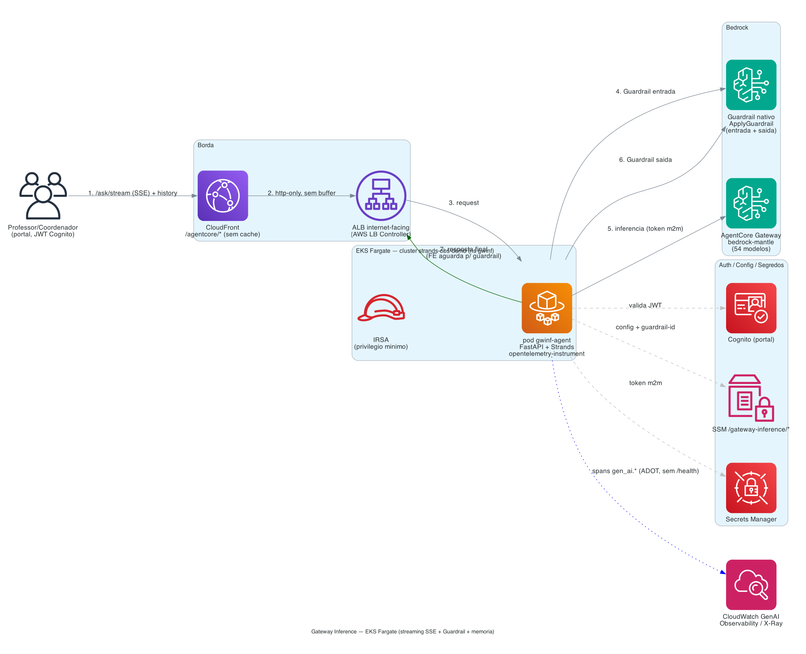
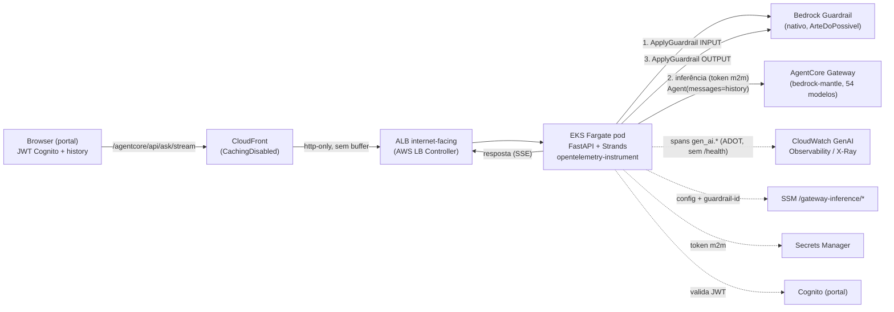

# Gateway Inference — backend no EKS Fargate (streaming SSE)

Backend do módulo **AgentCore → Gateway Inference** rodando no **Amazon EKS Fargate**
(cluster `strands-obs-demo`, us-east-1), com **streaming via SSE**, **Guardrail nativo do
Bedrock**, **memória de conversa** e **observability nativa** (spans `gen_ai.*` no
CloudWatch GenAI Observability / X-Ray).

> **Nota de comportamento:** o backend sempre streama (SSE). O **chat Inference** hoje
> **bufferiza no navegador** e só exibe a resposta **final** (depois do Guardrail de saída),
> para nunca mostrar texto que seria bloqueado. A **Evaluation** mostra o streaming **ao
> vivo** por modelo (o veredito do juiz vem depois).

## Problema real

Professores/coordenadores precisam de um chat que **responde progressivamente** (como um
assistente de verdade), não um spinner que trava até a resposta inteira chegar. O caminho
anterior (AgentCore Runtime + Lambda atrás de API Gateway) **bufferiza** a resposta — não há
SSE. Um pod vivo atrás de um ALB mantém a conexão aberta e **streama** os deltas. Foi por
isso que validamos a PoC de EKS no Fargate.

## Por que EKS/Fargate (e não Lambda)

- **API Gateway + Lambda** entregam a resposta em bloco (sem streaming incremental).
- **EKS Fargate**: pod FastAPI de longa duração atrás de um **ALB**; o CloudFront encaminha
  a resposta em chunks (sem cache) → **streaming real** ponta a ponta. Verificado: chunks
  chegando incrementalmente através do CloudFront (não há buffering na borda).
- Sem servidor para manter (Fargate serverless); paga-se pelo uso do pod.

## Arquitetura



> Fonte do diagrama (versionado): `docs/architecture/gateway-inference-eks.py`
> (skill `aws-architecture-diagram`). Render: `python3 docs/architecture/gateway-inference-eks.py`.

<details><summary>Versão Mermaid (renderiza no GitHub)</summary>


</details>

- **Roteamento por API** (igual ao runtime `agent.py`): `anthropic.*` → `AnthropicModel`;
  `openai.gpt-5*`/`gpt-oss*` (não-safeguard) → `OpenAIResponsesModel`; resto → `OpenAIModel`.
  Todos apontando para o **base_url do Gateway** com o token OAuth m2m.
- **Auth**: o app valida o **JWT do Cognito do portal** (pool `POOL_ID`, `token_use`
  access|id, assinatura via JWKS). O browser nunca vê o segredo m2m nem fala com o Gateway.
- **Memória de conversa (chat multi-turno)**: o frontend mantém o histórico da conversa e
  o envia no campo `history`; o backend **semeia o `Agent` Strands** com os turnos
  anteriores (`Agent(messages=…)`). Assim o chat resolve referências ("essa cidade", "ele").
  O pod fica **stateless** (memória vive no cliente; sobrevive a restart/scale). "Nova
  conversa" limpa a memória. A **Evaluation** roda **sem** histórico (cada modelo isolado).
  Para memória **persistente/cross-sessão**, o caminho nativo seria o **AgentCore Memory**
  (follow-up).
- **Guardrail (nativo do Bedrock)**: como a inferência passa pelo Gateway (APIs
  OpenAI/Anthropic-compatíveis, sem `guardrailConfig`), aplicamos o Guardrail como uma
  verificação **independente** via **`ApplyGuardrail`** — na **entrada** (bloqueia antes de
  gastar tokens) e na **saída** (avalia o texto gerado). Vale para **Inference** e
  **Evaluation**. Id/versão em `SSM /gateway-inference/guardrail-{id,version}` (vazio =
  desativado). IAM: `bedrock:ApplyGuardrail`.
- **Observability**: processo sob `opentelemetry-instrument` (ADOT `aws_distro`); o Strands
  emite spans `gen_ai.*` → endpoint OTLP do X-Ray (Transaction Search) → CloudWatch. O
  healthcheck do ALB (`/health`) é **excluído** da instrumentação
  (`OTEL_PYTHON_FASTAPI_EXCLUDED_URLS=health`) para não poluir a observability.

## Rotas (sob `/agentcore/api/*` no CloudFront; também na raiz p/ o healthcheck do ALB)

| Método | Rota            | Uso |
|--------|-----------------|-----|
| GET    | `/health`       | healthcheck (ALB) |
| GET    | `/models`       | modelos do Gateway (agrupados por provider) |
| POST   | `/ask`          | resposta **completa** em JSON — usada pela **Evaluation** (judge) |
| POST   | `/ask/stream`   | **SSE** — usada pelo **chat Inference** e pelos candidatos da **Evaluation** |
| GET    | `/mantle/metrics` | uso do Gateway (CloudWatch `AWS/BedrockMantle`) |

Corpo de `/ask` e `/ask/stream`: `{question, model, system_prompt?, conv?, history?}`.
`history` = `[{role:"user"|"assistant", text}]` (memória; usado só pelo chat Inference).

Formato SSE: `data: {"type":"delta","text":"…"}` … `data: {"type":"done","model","debug"}`
(ou `{"type":"error"}`). O `debug.guardrail` traz `{blocked, stage}` (`input`/`output`/`pass`);
em bloqueio de entrada a mensagem do Guardrail vem como um único `delta`. O **chat Inference**
consome esse SSE mas **só renderiza no `done`** (aguarda o Guardrail de saída); a
**Evaluation** renderiza os `delta` ao vivo em cada card.

## Estrutura

```
eks/
  app/                 server.py (FastAPI+Strands+Guardrail+memória), requirements, Dockerfile, buildspec
  k8s/                 deployment.yaml (Deployment+Service, env ADOT + exclusão /health), ingress.yaml (ALB)
  iam/                 agent-irsa-policy.json (SSM/Secrets/CloudWatch/ApplyGuardrail + telemetria)
  docs/architecture/   gateway-inference-eks.py + .png (diagrama versionado)
  build-image.sh       build da imagem na nuvem (CodeBuild -> ECR gateway-inference-eks)
  alb-controller.sh    instala o AWS Load Balancer Controller (helm + IRSA)
  deploy-eks.sh        log group + resource policy X-Ray + IRSA + Deployment/Service
  cloudfront_repoint.py  repontar a origin /agentcore/* p/ o ALB (e --restore de volta)
```

> Imagem atual: `gateway-inference-eks:v4` (`IMAGE_TAG=vN ./build-image.sh` para novas versões).

## Deploy (reprodutível)

```bash
# 0) creds no ../../.env (AWS_REGION etc.)
cd agentcore-gateway-inference/eks

./build-image.sh                       # CodeBuild -> ECR :v1 (IMAGE_TAG=v2 p/ nova versão)
./alb-controller.sh                    # 1x por cluster (idempotente)
./deploy-eks.sh                        # namespace gwinf + IRSA + Deployment/Service
kubectl -n gwinf apply -f k8s/ingress.yaml
ALB=$(kubectl -n gwinf get ing gwinf -o jsonpath='{.status.loadBalancer.ingress[0].hostname}')

# repontar o portal (usar um python com boto3)
python cloudfront_repoint.py --dist <DIST_ID> --alb "$ALB"
```

> **Fargate:** o namespace `gwinf` precisa de um Fargate profile (`fp-gwinf`,
> `namespace=gwinf`) — senão o pod fica `Pending` (taint `compute-type: fargate`).

## Verificação (feita)

- `/agentcore/api/health` → 200; `/models` sem token → 401.
- **Streaming pela borda**: chunks SSE incrementais chegando via CloudFront (sem buffering
  na borda). O chat Inference opta por buffering **no FE** (aguarda o Guardrail de saída).
- **Memória**: turno 1 "capital da França" → "Paris"; turno 2 "quantos habitantes tem
  **essa cidade**?" (com `history`) respondeu sobre Paris — contexto preservado.
- **Evaluation**: cada modelo candidato streama ao vivo no seu card; o juiz roda depois.
- **Observability**: spans `gen_ai.*` do `service.name=gwinf-eks-agent` aparecem no X-Ray /
  CloudWatch GenAI Observability. Requer a resource policy `TransactionSearchXRayAccess`
  autorizando `logs:PutLogEvents` no `/aws/gwinf-eks/agent` (o `deploy-eks.sh` faz isso).
  Spans de `/health` **não** aparecem (excluídos da instrumentação).
- **Guardrail**: verificado com a versão `1` do guardrail (tópico negado "Palmeiras") —
  pergunta sobre o tópico é **bloqueada na entrada** (mensagem do Guardrail, sem gastar
  tokens do modelo); prompts normais passam (`guardrail: OK`). Vale em Inference e Evaluation.

## Segurança — estado atual e follow-ups

- **JWT do portal** é validado no app (assinatura + issuer + `token_use`).
- Segredo m2m no **Secrets Manager**; config no **SSM**; **IRSA de privilégio mínimo**
  (sem Bedrock direto — a inferência passa pelo Gateway com token).
- **Follow-up (endurecer a borda):** o ALB é `internet-facing`. Para atender ao princípio
  "nada acessível fora do CloudFront", adicionar (a) header secreto de origem do CloudFront
  validado no app e/ou (b) restringir o security group do ALB à *managed prefix list* do
  CloudFront. Hoje a proteção efetiva é o JWT.

## Relação com o caminho Runtime+Lambda

Este backend **substitui** o caminho Runtime+Lambda para o chat (que não fazia streaming).
O frontend (`frontend/app.js`) foi repontado: o chat consome `/ask/stream` (SSE); a
Evaluation continua em `/ask` (JSON). O Runtime `gateway_inference-*` e a stack
`agentcore-gateway-inference` podem ser removidos depois de validado o EKS.

## Teardown

```bash
kubectl -n gwinf delete -f k8s/ingress.yaml      # remove o ALB
kubectl delete namespace gwinf                    # remove Deployment/Service
python cloudfront_repoint.py --dist <DIST_ID> --restore <api-domain>   # volta p/ HTTP API
# opcional: aws eks delete-fargate-profile --fargate-profile-name fp-gwinf ...
```
